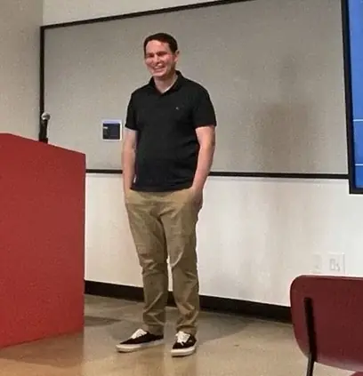

My name is Ryan Bohman, and I created this website, Gnosis Health, to allow individuals to connect with my current work and interests.

Some thing that keep me busy:

- **Counseling:** I have a small client load as I continue my graduate studies with the University of Rochester. I am not at this moment taking on any more clinical clients for individual counseling, but if that changes in the future, I’ll post it here.
- **Research:** I am researching areas of interest to me. These include areas within mental health and technology. I am interested right now in psychodynamic theory and neurophysiological data.
- **Book Clubs:** Since 2019, I have been running book clubs on Meetup. I have [one in NYC which I founded and co-host with partners](https://www.meetup.com/reading-philosophy/) and [another in Rochester, NY where I co-host events](https://www.meetup.com/philosophy-cafe-in-rochester-ny/).

For information about working together in a business sense [please see here](/doing-business/).

Anyway, thanks for stopping by this corner of the web. There is a photo of me below.

Ryan

