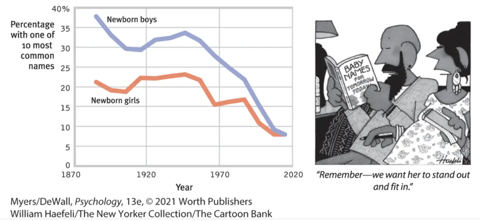

I wrote this paper, "Reprogramming the Subconscious Mind," for a first-year undergraduate psychology course from Fall 2023 at City College. We were given a structured template and had to elaborate on how parents, peers, and culture can influence the subconscious mind. The assignment asked how we can reprogram our subconscious mind. Professors instructed us to use course material and draw on this video from [TikTok from Anna Akana](https://www.tiktok.com/@annaakana/video/7224171744204999979?_r=1&_t=8bkkecLlbMk) that took a fun look at the subconscious. I have displayed my response below.

**Reprogramming the Subconscious Mind**

The purpose of this paper is to explore the psychological and cultural influences that help shape how we think, feel, and behave. I will examine evidence that thoughts and emotions are affected by parents, peers, and societal expectations. I will then consider how these influences might exist subconsciously and what can be done to modify subconscious tendencies. Let’s begin with parental influences. Parents matter by the genes they provide to their children and by the style of parenting they provide to the child. Starting from birth, humans develop intense bonds with their parents or caretakers, known as attachments. Attachments shape the way we relate to individuals for the rest of our lives. Erik Erikson’s research found that attachments can either be secure or insecure. Secure attachment was developed when the parent or caretaker was sensitive and responsive, leading to the development of basic trust. Insecure attachment occurs when the primary caregiver is insensitive and unresponsive, leading to mistrust. A child with insecure attachment may be afraid to explore their surroundings and may become distressed when their caretaker leaves. Two types of insecure attachment have been identified: anxious and avoidant. Anxious attachment is when the individual craves attention but is simultaneously vigilant to rejection. Avoidant attachment is when the individual feels discomfort being close to others. Anxious attachments may result in clingy and jealous behavior in romantic relationships, whilst avoidant attachments may result in a lack of commitment and increased levels of conflict. Researchers now believe this basic trust is not genetic; it is a result of the secure attachment. An experiment which placed babies with “difficult” temperaments with trained, attentive mothers for 5 months showed that most of the difficult babies became securely attached after the time with the trained mother. This research supports the view that attachment style is not genetic temperament but related directly to parenting.

Interactions with peers also influence how we think, feel, and behave, especially during childhood and adolescence. For example, preschoolers who don’t like a certain food will be more likely to eat it when around their peer group friends. Children who learn English will be more likely to copy their peer group’s accent instead of their parents’ accent. Teens who smoke often took up the habit after modeling themselves on individuals in their peer group who smoke. Selection effect, which refers to individuals seeking out other people who are similar to them in attitudes, interests and traits, shapes who our peers are. We often choose our mating partners from our peer groups, so selection effect may cause us to choose romantic partners who are similar to ourselves.

Cultures vary, cultures change, and cultures shape our lives. Culture affects our behaviors, our conception of ourselves, and how our children are raised. Culture is actions and beliefs that are shared by a group of people and passed on from one generation to the next. Culture can account for how work is divided between types of individuals in a group, for example via social roles like gender roles. Culture also allows for the passing on of knowledge between people, giving rise to a preservation of innovation and the advanced technologies we see today. A cultural norm is a practice or value that is considered normal within one culture but may be different in another. For example, I am from Australia, and we have a cultural norm called “mateship,” which means that one should be friendly and loyal to those around them and foster equality. A second example is the cultural norm “tall poppy syndrome,” where, in Australia, successful people who excel above others are often criticized. When I moved to New York, I received culture shock by seeing how individuals are encouraged and rewarded for being successful and beating others in competition. Individualistic cultures value each person having a unique sense of self with personalized goals and values that stem from their own unique traits. Collectivist cultures instead have the individual define their goals and values more by the family, friends, and groups they belong to. Figure 1 shows over the last 150 or so years in America, the most common names of newborns, both male and female. People are now choosing names that are more unique, presenting an increasing trend of individualism in America. Today, as a New Yorker, I see myself as part of an individualistic culture. Culture can also influence the amount of emotional intimacy between family members, including between child and parent. In the west, families often value independence and uniqueness instead of loyalty or respect to traditions. Some Asian and African cultures tend to value emotional closeness more. In these cultures, children may often spend their entire days close to a family member. These cultures encourage identity for the individual to be derived more from the family self.

**Figure 1**

Anna Akana speaks in her TikTok video about how early formative experiences with our primary caregivers frame how we think, feel and behave as adults. She characterizes her own psychological struggles as an adult as a battle between her conscious and subconscious minds. In doing this, Anna Akana follows views somewhat similar to psychologist Sigmund Freud and psychoanalytic psychology. When Anna Akana reveals her beliefs that love is suffering or that everyone she loves will leave or die, she may be demonstrating insecure attachment, with a basic mistrust in relationships. An avoidant romantic attachment style may have developed because of interactions with her primary caregiver(s), if they were insensitive and unresponsive. Anna Akana does not show anxious attachment signs of clinginess or jealousy, but does try to sever her relationship (self-sabotage) with the person; this may be an avoidant strategy. Anna Akana has two other concerns: in her career she fears being bad or disliked if she is successful, secondly she fears that her attractiveness will not live up to beauty standards. Parents could have shaped these fears. Her parents may have been authoritarian, similar to the characters played at the start of the skit. Authoritarian parenting may cause low self esteem and over reacting when conflicted, leading potentially to not feeling attractive. Her parents may have also been more collectivist in culture, prioritizing the success of the group over the individual. This may have caused fear of standing apart with individualized career success. Peer groups may have influenced beliefs about attractiveness and work. Anna Akana may have chosen peers who were similar to her, due to the selection effect, reinforcing her own views. Culture may have influenced Anna Akana’s views on attractiveness and career success. As an Asian American with a sexual preference which includes women, Anna Akana may have experienced racism, sexism, or varying degrees of marginalization from culture, contributing to her present disposition. The views of Anna Akana’s may be deeply rooted in her subconscious. Developmentally, effects of parents, peers, and culture impress themselves on individuals from a very young age, starting in infancy. Most of us cannot recall memories prior to the age of 4, but they may be stored in our subconscious. As we develop further, our subconscious too continues to develop. Confirmation bias, which is the tendency to seek out information that supports our already existing views, may have acted as a reinforcement pattern for belief systems and behaviors.

Anna Akana wants to change. She wants to reprogram her subconscious mind. Early experiences with parents, peers, and culture are so hard to overcome because from within the womb to early adolescence, the brain is developing a lot, and from adolescence to around age twenty five the brain prunes but still grows rapidly as the prefrontal cortex matures. Early experiences affect us biologically and psychologically through the formation of schemas or scaffolds due to experiences and interactions with family and peers. We also are formed at an early age by culture. Culture can be difficult to reject if one is part of it. These three effects are known as bio-psycho-social and play a key role in the development of who we are. Therapy may be a tool to help us think, feel, or behave differently than we are used to. It provides an opportunity to explore our own mind and find opportunities to build new ways of being. We cannot blame our own behavior solely on our genes or influences. The decisions we make today shape who we become tomorrow. We have the ability to update our neurology by neuroplasticity. Neurons that fire together wire together. Awareness alone, though, is not enough, and we do need new supportive peer groups, environments, and constant practice in order to achieve lasting change.
