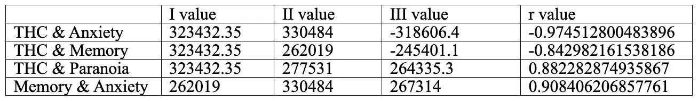
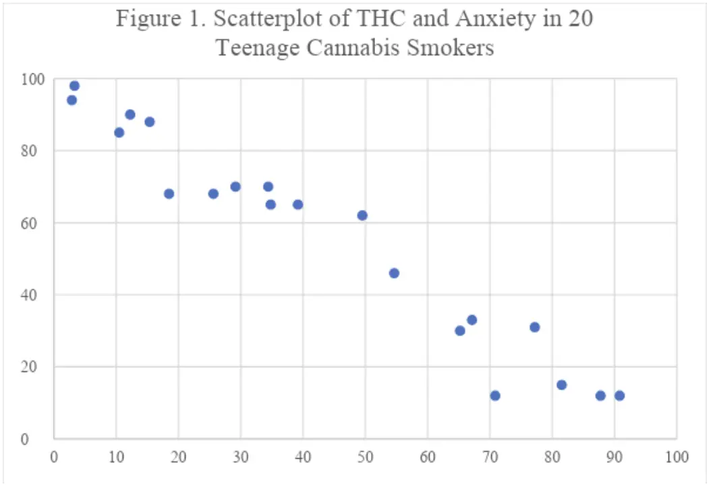

This paper, written for a first-year undergraduate psychology course at City College in Fall 2023, uses the correlational method to explore the link between rising THC levels in cannabis and its psychological effects on adolescents.

**Using the Correlational Method to Study Cannabis Use in the Adolescent Brain**

The purpose of this paper is to evaluate the correlational method as a means for examining the relationship between levels of THC in cannabis and various psychological functions in teenagers. I will compare the functioning of 20 students at a local high school who smoke cannabis daily. In many ways, the brains of adolescents are the most vulnerable to the adverse effects of smoking cannabis. According to a New York Times article by Caron (2022), the last few years have seen a rise in high concentration THC cannabis products. In 1995 cannabis contained about 4% THC; newer products today contain much more, in some cases over 95%. Higher THC, combined with trends of new technology such as vaping and youth-directed, colorful marketing is causing teenagers to become addicted at a higher rate and to develop severe illness. An MRI study by Albaugh et al. (2021) found that cannabis use in 14- to 19-year-olds over five years led to structural changes in their developing brains, including thinning of the cerebral cortex, similar to that found in degenerative aging. The effects were dose dependent implying, the more cannabis used, the worse the brain effect. The study linked these brain changes to increased impulsivity and cited other research indicating potential changes in the brain affecting social skills, motivation and memory. According to research by Lonsdale et al. (2021), another impact of regular cannabis use is cannabis hyperemesis (CH). Originally thought to be rare, the study shows CH is an increasing concern, especially among children. CH causes chronic vomiting, along with nausea, abdominal pain and changes in bowel movements. The study found that no medication seemed to offer relief for CH symptoms, although patients found that a hot shower or bath made them feel better, leading to compulsive bathing habits. In summary, recent scientific evidence suggests that adolescents are the most vulnerable to the adverse effects of smoking cannabis because their brains are still developing. Additionally, developing brains are more severely impacted by the increases in THC concentration being seen in cannabis. Adolescents with developing brains also have less decision making skills; they may be more susceptible to new cannabis ingestion technology, increased cannabis availability and marketing. Teens are dosing at higher rates and becoming more addicted than before; making them vulnerable to serious mental and physical illness.

Teenage use of high-potency cannabis may even lead to permanent psychiatric symptoms, including the development of psychotic symptoms. Psychosis is a temporary or permanent state where one loses touch with reality. It can be a symptom of illnesses such as schizophrenia or induced by substances such as cannabis. Symptoms of psychosis include hallucinations, delusions, disorganized speech, abnormal muscle movement, impaired emotions or decreased motivation. Research by Di Forti et al. (2019) found evidence that daily cannabis use tripled the odds of developing psychotic symptoms (odds factor of 3.2). The risks increase as THC content increases. High THC content (>10%) makes users almost five times more likely to develop psychosis than non cannabis users (odds factor of 4.8). The study also found evidence that children who started to use high potency THC at 15 years of age or under, were over twice as likely to develop psychosis (odds factor of 2.3), compared to those who have never smoked by that age.

Evidence also suggests that cannabis use can have effects on everyday cognitive functioning, such as short-term memory, and on symptoms of anxiety. The U.S. Department of Health & Human Services (2019) reports that frequent cannabis use in adolescence leads to short-term memory deficits and produces anxiety. These points are supported by Caron (2022) in The New York Times; while CBD in cannabis may decrease anxiety, THC tends to increase it. In my view, in light of this information, cannabis appears bad at treating anxiety. This study seeks to test the hypothesis that increased THC content in cannabis significantly alters user anxiety levels as well as paranoia and memory performance. I will also test any link between anxiety and memory. I will apply the correlational method to evaluate this hypothesis by measuring each individual's average THC, and assessing their levels of anxiety, paranoia and memory using standard measurement instruments. Pearson coefficient will be used to calculate four correlation coefficients, between THC and each of the three psychological measures and between memory and anxiety.

Data were collected from a group of 20 adolescents (ages 14-18) who use cannabis daily to test the hypothesis using the correlational method. Each group completed three standardized psychological measures: (1) a short-term memory performance test, (2) a survey measuring their state of anxiety, and (3) a measure of their paranoia symptoms. I predict a pattern where THC is linked to harmful consequences; I predict a positive correlation between THC and anxiety, a negative correlation between THC and memory, and a positive correlation between THC and paranoia. In a scatterplot, each dot represents a pair of measurements for each subject. In total, the dots contribute to an overall trend, if one exists. The more linear the graph, the stronger the correlation; the less linear (more ‘scattered’), the weaker the correlation. Figure 1 below depicts a negative correlation between THC and Anxiety, meaning that an increase of THC levels resulted in a decrease of anxiety. The following results were obtained:

X- axis : THC

Y-axis : Anxiety

The results of the correlational method were valuable in addressing the hypothesis under study. However, several of the findings require future consideration. I hypothesized that there exists a correlation between THC content and user anxiety levels, as well as paranoia and memory performance. I also hypothesized a link between anxiety and memory. The results were consistent with the hypothesis as there was a positive correlation between THC and paranoia, and a negative correlation between THC and memory. However, surprisingly, there was a negative correlation between THC and anxiety as opposed to the predicted positive, challenging existing research. Contrary to predictions, there was a positive correlation between memory and anxiety. The relationship in Figure 1 could be explained by the individual differences in the way subjects each used cannabis; for example some dosages, strain, forms of ingestion, or use types might actually truly decrease anxiety. The positive correlation between memory and anxiety is very interesting and leads me to speculate that memories may be a factor here. Namely, I wonder if traumatic memories altered the results in our study. I speculate high that one hypothesis could be that THC may block out painful memories, leading to lowered anxiety; this effect may be unique to those with trauma and provide an explanation why our results differ from existing research. Only those with traumatic memories gain decreased anxiety from high THC, for those without, it increases anxiety. Future repetitions of this study should incorporate PTSD scales to account for the potential of our speculated hidden variable, traumatic memories. I would also improve by gathering more detailed information on cannabis use, for example, what forms subjects used and more exact information on length, frequency and dosage of use. This study was a correlational study where the effects of the hypothesis were evaluated. Correlational studies only determine a relationship between variables, not causation. In order to identify causation, an experiment manipulating an independent variable could be conducted. In this case, however, it would be considered unethical to give teenagers dangerous levels of THC to study them, so a correlational design is a more ethical approach. There may be ways we can conduct ethical experiments that may give us more information, such as a quasi-experimental design. In conclusion, existing research indicates that using high THC content cannabis has a variety of damaging impacts on the developing brain from cortical thinning, leading to poor impulse control, cognitive decline, anxiety, paranoia and memory loss. My results demonstrated that not all cases of cannabis may increase anxiety, and showed cannabis use correlated with decreased anxiety. These results indicate that another variable is at play here, whether it be traumatic memories or different methods of cannabis usage. Our findings deliver great interest for the field that warrant further investigation. Further research is necessary, especially to confirm findings and establish causal relationships.

**References**

Albaugh, M. D., Ottino-Gonzalez, J., et al. (2021). Association of cannabis use during adolescence with neurodevelopment. \*JAMA Psychiatry, 78\*(9), 1031-1040. <https://doi.org/10.1001/jamapsychiatry.2021.1258>

Caron, C. (2022, June 23). Psychosis, addiction, chronic vomiting: As weed becomes more potent, teens are getting sick. \*The New York Times\*. Updated 2023, June 22. <https://www.nytimes.com/2022/06/23/well/mind/teens-thc-cannabis.html>

Di Forti, M., Quattrone, D., et al. (2019). The contribution of cannabis use to variation in the incidence of psychotic disorder across Europe (EU-GEI): A multicentre case-control study. \*The Lancet Psychiatry, 6\*(5), 427-436. <https://doi.org/10.1016/S2215-0366(19)30048-3>

Lonsdale, H., Kimsey, K. M., et al. (2021). Pediatric cannabinoid hyperemesis: A single institution 10-year case series. \*Journal of Adolescent Health, 68\*(2), 255-261. <https://doi.org/10.1016/j.jadohealth.2020.09.024>

U.S. Department of Health & Human Services. (n.d.). Cannabis's impact on the developing brain. Retrieved 10/20/2023, from <https://www.hhs.gov/surgeongeneral/reports-and-publications/addiction-and-substance-misuse/advisory-on-cannabis-use-and-developing-brain/index.html>
