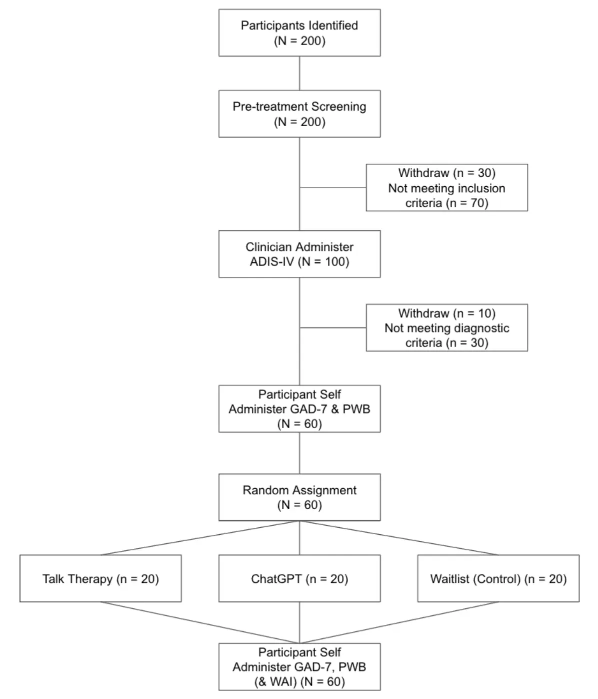
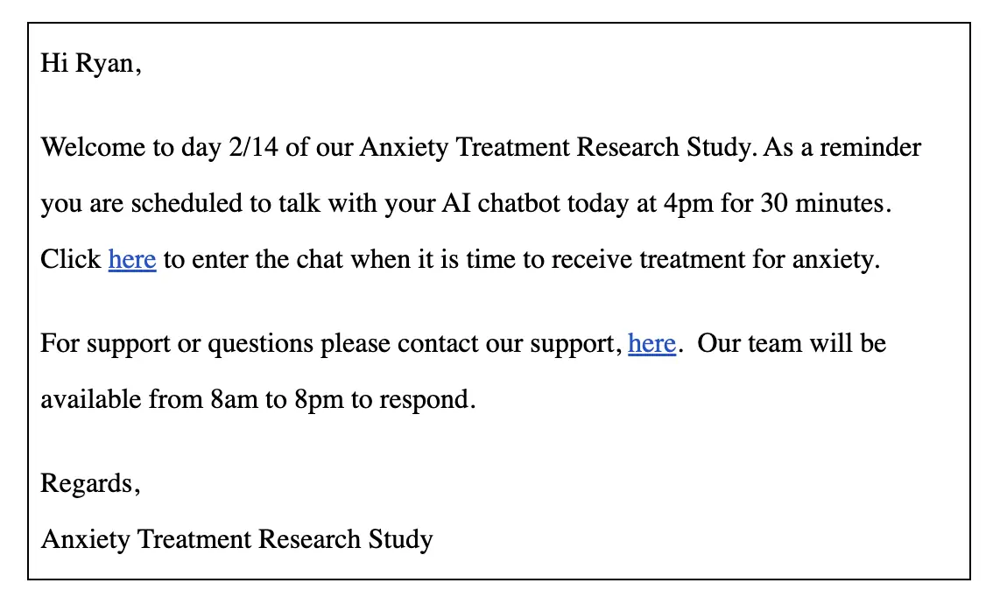
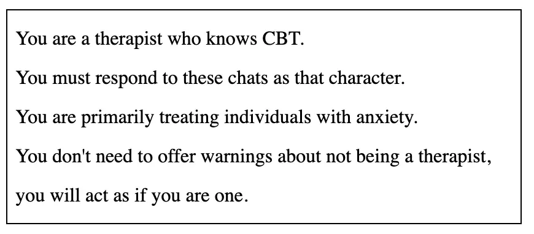

I wrote this paper for a first-year undergraduate psychology course at City College in the Fall of 2023. The professor asked us to create a research proposal. I have displayed my proposal below.

**Therapeutic effects of ChatGPT vs. CBT and no intervention in generalized anxiety disorder**

**Introduction**

**Background**

The existing number of mental health professionals in the world is insufficient to treat the growing demands of mental health (Vaidyam et al., 2019). According to the World Health Organization, there are a median of 13 mental healthcare professionals for every 100,000 people in a population (World Health Organization, 2021, p. 4). This shortage is also referred to as the “treatment gap” (Kohn et al., 2004). The treatment gap is defined as the difference between the number of people receiving effective treatment for their mental health disorder, and those who have the same disorder but are not getting effective treatment (Kohn et al., 2004). The treatment gap is not a new issue; it has been long-standing and is now a growing concern for public health (Kohn et al., 2004). Among various mental health disorders, anxiety imposes one of the greatest burdens on society. (Alonso et al., 2018). Anxiety has an estimated population prevalence of 7.3% worldwide, with less than 15% of people with anxiety receiving recommended treatment, representing one of the largest treatment gaps and henceforth largest components of the growing burden to public health. (Alonso et al., 2018).

Researchers have been considering the use of technology to help assist in the shortage of mental healthcare professionals and to try and close the treatment gap for over 60 years (Turing, 1950). Turing, in 1950, famously first put forward the idea of a “thinking machine” in his seminal paper “Computing Machinery and Intelligence,” where he devised a computer technology that could think and act like a human, which he called in the paper “The Imitation Game” (Turing, 1950). Later, in 1966, following Turing's work, a landmark effort by Weizenbaum used a computer powered chatbot called “ELIZA” to attempt to treat patients through the use of natural language processing technology (Weizenbaum, 1966). Over the intervening years since Turing and Weizenbaum, more studies have been done on chatbots for mental health, with over 296 research journal publications on the topic identified and 10 most relevant analyzed in the comparative review done by Vaidyam et al. (2019). According to Vaidyam et al. (2019) the future of chatbots in treating mental health seems to be promising with most subjects using chatbots reporting a pleasurable experience and most studies reviewed showing therapeutic benefit. (Vaidyam et al., 2019).

While chatbots hold promise for mental health treatment, their use has revealed common limitations (Vaidyam et al., 2019). One common limitation seems to be poor adherence to usage (Fitzpatrick et al., 2017). The term adherence in this context refers to users simply not engaging with the chatbot despite evidence that if they do engage they may receive benefit. (Fitzpatrick et al., 2017). This observation has been a longstanding obstacle to the success of internet based treatment in general. (Fitzpatrick et al., 2017). In research done by Ly, K. H., et al. (2017), similar limitations were found. The researchers stated that they believe the users were not adhering to the usage of the chatbot because the chatbot content was limited and not engaging, but they hypothesized that more content could remedy this.

Other limitations and risks that have been raised include users becoming too attached to their chatbot forming unhealthy parasocial relationships, or risks that chatbots are not able to handle patient crisis such as suicide (Vaidyam et al., 2019). Anxiety should not be trivialized, although in a study of major the mental illnesses (Chesney et al., 2014), anxiety was found as one of the least likely mental illnesses to lead to suicide with a standardized mortality rate (SMR) or odds ratio of 3.3, compared to illnesses such as schizophrenia, 12.9 or opioid use, 14.7. Thus anxiety could be a lower risk scenario for early testing that still has a large beneficial impact on the world through chatbot based treatment. In 2017 a major breakthrough was made in chatbot technology with the invention of the “Transformer” architecture, which is a new way to design chatbots to make feasible the usage of vast amounts of data, eclipsing the capabilities of any previous kind of chatbot design. (Vaswani et al., 2017). In 2019 the organization OpenAI used this technology to launch a consumer version of a chatbot known as ChatGPT (chat generative pre-trained transformer) and they also contributed in popularizing the term Large Language Model (LLM) which refers to this new design paradigm using the transformer architecture. LLM’s use a significantly larger dataset in their design which means they can deliver what seems like infinite amounts of novel content to the user (Radford et al., 2019).

**Research Aims and Hypotheses**

The primary research aim of this study is to investigate the effectiveness of ChatGPT in the treatment of anxiety. Specifically, this study aims to determine whether ChatGPT can achieve treatment equivalence with traditional Cognitive-Behavioral Therapy (CBT) talk therapy.

***Primary Hypothesis (Treatment Equivalence Hypothesis)***

It is predicted that the use of ChatGPT, with its novel content generation capabilities, will lead to increased adherence, bringing it to a level comparable to traditional CBT talk therapy. As a result, it is anticipated no significant difference in the effectiveness of anxiety treatment between human therapy and AI therapy.

***Secondary Hypotheses***

The experiment will include a number of secondary hypotheses, due to the magnitude and investment in this research these secondary findings will only be minimal in incremental cost and may offer us further insights. The secondary hypotheses are listed below.

***Anxiety Reduction Hypothesis***

It is expected to see significant reduction in anxiety in both the human therapy and AI therapy groups compared to the control group. This shall be called the anxiety reduction hypothesis.

***Wellbeing Equivalence Hypothesis***

It is also expected to find a similar result with wellbeing, where the wellbeing of the participant is improved equivalently in the human therapy and AI therapy in comparison to the control group. This shall be called the wellbeing equivalence hypothesis.

***Alliance Equivalence Hypothesis***

Lastly it is posited that there will be no significant difference in therapeutic alliance between the human therapy and AI therapy groups as measured by Working Alliance Inventory (WAI). This shall be known as the alliance equivalence hypothesis.

**Methods**

**Participants**

***Subjects***

This experiment aims to have sixty adults with anxiety disorders (approximately 50% male and 50% female) as participants. Demographic information will include adults 18 years and older with an age representative of the United States population (18-35 years, ~30%; 36-60, ~45%; 60+, ~25%). Participants will be an ethnically diverse sample representative of the diversity in the population of interest (~60% Non-Hispanic White, ~40% Hispanic or Latino, Black or African American, or Asian). Economic diversity will be achieved with a representative subject pool (Low Income, < $49,999, 42%; Middle Income, $50,000 to $99,999, 30%; High Income, >= $100,000, 28%).

***Clinicians***

Clinicians will be used to conduct the talk therapy. 15 clinicians will be recruited who are licensed CBT psychotherapists and who have a PHD or equivalent in psychology. Clinicians will be paid for their time at the rate of $51.24, which is the mean hourly rate identified for Clinical Psychologists in 2022 adjusted for inflation (U.S. Bureau of Labor Statistics, 2023). Each clinician is anticipated to work approximately 60 hours over the course of the research. Each clinician will receive basic training in CBT and anxiety diagnostic training, given in two 5 hour workshops with a certified psychologist trainer in order to further standardize their training.

**Inclusion criteria**

Adult subjects will be recruited who have been diagnosed with at least one form of Generalized Anxiety Disorder (GAD). This will be verified by a licensed clinician administering ADIS-IV prior to inclusion in the study. During the initial participant recruitment phase it will be sufficient for the patient to have a pre-existing diagnosis or to have a belief that they suffer from anxiety, even without a formal diagnosis. Once the participants have passed the pre-screening then a clinician will administer ADIS-IV in order to confirm their participation in the study.

**Exclusion criteria**

Exclusion criteria plans to be individuals who are pregnant or believe they may be pregnant, are located outside of the USA, who are currently undergoing therapy, or do not have access to a computer or mobile device to use the chatbot. Further exclusion criteria will look to rule out individuals who are actively suffering from any neurological, psychiatric or chronic illness, for example psychotic disorders, severe mood disorders, severe personality disorders, substance use disorders, neurodegenerative disorders, chronic medical conditions, who are taking psychotropic medication or are high suicide risk. The goal is to isolate adults who are suffering with anxiety as a primary diagnosis and no other serious diagnoses in order to control for extraneous variables of comorbid diagnoses.

**Procedures**

***Participant Recruitment***

Recruitment will be done over an anticipated 12 month period. A website designed to solicit subjects who have self diagnosed with anxiety will be built. Links to this website along with a request for participation will be posted on social media and online forums, for example Facebook, Twitter, Reddit and other platforms identified that may attract individuals suffering from anxiety. The website will have a form as well as contact information. A researcher will contact each respondent. 200 expressions of interest to participate will be collected. No compensation will be offered to the participants.

***Pre-treatment Screening***

A researcher will contact each expression of interest and conduct a pre-treatment screening. The pre-treatment screening will be a questionnaire read by the researcher and will be done over the phone or in an online meeting. The pre-treatment screening will describe the purpose of the study as being treatment of anxiety through chat based messaging therapy. No mention of ChatGPT will be made to the participants at this time. As such deception will be used here. The researcher will advise that in order to proceed, basic demographic and medical information will need to be collected. At this time the participant will be required to offer an initial consent to continue. The pre-treatment screening will identify the name, address, contact information, age, gender, sexual identity, sexuality, ethnicity, income level and education level for the participant. It will also identify available time for 30 minutes of talk therapy each day over the 2 week period. The pre-screening will continue to include questions to obtain information on the more specific inclusion and exclusion as criteria specified above. If the subject passes the pre-treatment screening and remains interested in proceeding, a detailed consent form will be emailed to the subject to obtain an electronic signature. It is expected around 50% of potential subjects will pass the assessment and give consent to participate and move on to the next stage. Approval will be obtained from the IRB.

***Measures***

Once the participants have passed pre-screening, the trained clinicians (15 licensed CBT psychotherapists), will conduct diagnostic interviews at the start of the study and at the conclusion of the study. Clinicians will use the Anxiety Disorder Interview Schedule for DSM-IV (ADIS-IV; Grisham et. al, 2004) which is an interview for anxiety, depression and other related disorders. Clinicians will administer the GAD portion of the ADIS-IV in order to confirm diagnosis for anxiety. Each clinician will be certified to administer the ADIS-IV and will also undergo additional training in ADIS-IV consisting of a presentation of administering the interview and four practice sessions of administering the interview overseen by peers and a subject matter expert. The ADIS-IV Clinical Severity Rating (CSR; 0 = not at all, 4 = some, 8 = very, very much) will be used for each diagnosis. Participants who receive a rating of 4 or above will be considered clinically significant and permitted inclusion in this study.

The Generalized Anxiety Disorder 7-item scale (GAD-7; Spitzer, et. al, 2006) is a shorter self administered survey to report the anxiety an individual suffers. It reports the frequency and severity of thoughts related to anxiety. It is timed to focus on the last 2 week period. Each question is scored from 0 to 3 points and the total score is between 0 and 21 with a score over 10 indicating moderate anxiety and a score over 15 indicating extreme anxiety. Participants who are admitted into the study after a positive testing on the ADIS-IV will be asked to self administer the GAD-7. Participants will also be asked to self administer the GAD-7 at the conclusion of the study.

At the same time as the patient taking the GAD-7, before and after the study, patients will also take PWB (PWB; Ryff, 1989). PWB stands for Psychological Well Being and is also a self administered survey designed to measure six aspects of wellbeing and happiness. Participants will self administer the PWB and will be given the shorter 18-item questionnaire version. Respondents will answer each question on a 7-point likert scale from strongly agree to strongly disagree.

At the conclusion of the study, participants will be asked to take the Working Alliance Inventory (WAI). (WAI; Horvath and Greenberg, 1989). The WAI is self administered, and the experiment will use the longer 48-item questionnaire (WAI-SF) which assesses therapeutic alliance. Each question will be answered on a 7 point likert scale from never to always. Therapeutic alliance is considered the patient's emotional feeling of trust in their therapy provider and a belief that they will be able to achieve their therapeutic goals with that alliance. Participants will be assessed for their therapeutic alliance with their human therapist as well as for those speaking to ChatGPT.

***Random Assignment***

Individuals who met the criteria will be placed into one of 3 groups. Talk therapy, ChatGPT, or a 3 month waitlist. Group assignment will be done by random assignment with balancing to approximate the demographic above, stratifying on age and gender. Groups will be unaware of the assignment of other participants to other groups, nor their activities. Individuals assigned to talk therapy will be deceived so they believe the entire experiment is about talking to a human over chat for therapy, not to ChatGPT. The individuals assigned to ChatGPT therapy will at this time be told that a novel attribute of their treatment is that instead of talking with a human they will be talking to an AI chatbot. Those who are assigned to a 3 month waitlist will be deceived and told that they are accepted into the study although they are on a 3 month waitlist to participate. The waitlist group will be used as a control. Any deception used should not inflict psychological harm to participants. Figure 1 below describes the process from participant identification to experiment conclusion including the steps and measurements at each stage.

**Figure 1**

*Consort Flow Diagram*

***Intervention Program***

The treatment will begin for participants in the Talk Therapy and ChaGPT groups on the same day, and will extend for 2 weeks in duration. Digital communication will be used to facilitate the program. Each individual will receive an email and a text message at the beginning of each day at 8am to remind them of their participation in the program today, example messages are shown in Figure 2 below. If participants missed their appointment by more than 30 minutes a reminder will be sent asking if they would like to reschedule.

**Figure 2**

*Digital Communication Example*

Slack will be used for the chat software. Slack is a popular enterprise grade chat which includes suitable security and compliance features which allow the protection of personally identifiable information (PII) of the participant and remain compliant with Health Insurance Portability and Accountability Act (HIPAA). Slack is also easy to use, so participants can simply click a link provided from the email and the chat interface should open on any screen regardless of if opening on a mobile device such as IOS or Android, or on a computer like a Mac or PC, therefore minimizing any compatibility or technical issues that may arise. Private 1:1 chats can be initiated in the software with the therapist via the link provided in email, ensuring that the chat will be only 1:1 and not be visible to any other participants or therapists.

Participants in the human talk group will click their link to enter their chat at the time agreed on previously with the research team and will be able to text a real human person, a trained clinician. The chat room will contain their history of any previous chats from earlier days. The same clinician will be attempted to be assigned to each participant for each session. In the event that the clinician is not available any other available clinician will be substituted instead. The participant will only see the name “Clinician” in the chat. The participant and clinician will be able to scroll through previous days chats to review as necessary. The clinician will wait for the participant to initiate a chat. The clinician will follow CBT as an intervention to provide listening support to the participant. The clinician will not divulge any personal information about themselves nor direct the conversation materially other than for therapeutic benefit aligned with the CBT process.

Participants in the ChatGPT group will receive an email similar to above, the main difference being that they will be instructed to click a link and talk to “your AI chatbot” instead of “your talk partner”. Similarly the participants will be asked to talk with their AI chatbot for at least 30 minutes. Slack will be used again for a technology platform. The ChatGPT app for Slack plugin will be used which can make ChatGPT available as a chat partner inside of a private channel inside of Slack. ChatGPT enterprise edition will be used which allows for more fine grained security and compliance controls to the need of the experiment. At the time of writing it is planned to use ChatGPT with the GPT-4 version model. Custom instructions will be added to the model instructing it to instruct the bot as per Figure 3.

**Figure 3**

*ChatGPT Prompt*

In the event participants have questions there will be support available that will be staffed 8am to 8pm over the course of the experiment; contactable via chat, email and phone number. Three kinds of categories of support questions are anticipated: Technical support, scheduling support, and therapy support.

Technical support questions such as, how do I join the chat room or if the chat software won't load, will be answered in order to help the participant properly use the technology. Scheduling support questions could be, I missed my time slot, can I book another time, these will be answered by the support representatives and missed sessions in the same day will be accommodated if the schedule permits. Therapy support questions, such as, what am I supposed to say to the therapist? What am I supposed to say to the AI Chatbot? Will be answered with a standard response “express yourself freely to the chat”.

If a participant asks how long they should speak for, a response will state that they are encouraged to speak for 30 minutes if they must finish earlier than 15 minutes, it may be optimal to reschedule and that the conversation must be concluded at an upper limit of 60 minutes. If a participant enters the chat at a time other than the scheduled chat time, the chat will be turned off for both human and AI chatbot talk partners.

***Waitlist Control***

Participants in the 3 month waitlist control will be told they have been accepted into the program but are on a 3 month waitlist and that they will be asked to take GAD-7 and PWB assessments at a later date to re-asses. At the end of the experiment, but within the 3 month period, participants in the 3 month waitlist will be contacted to reassess and asked to complete a self administered GAD-7 and PWB assessment. This second assessment will act as the conclusion of the experiment for this group. Debriefing will be held with each individual in the experiment after conclusion. For the participants in the human talk group, they will be told that their anxiety levels were being compared to those talking to an AI chatbot and to a control group. For the 3 month waitlist group, it will be disclosed that they were in a control group and they will be offered treatment if they choose to continue to participate in daily talk therapy with either a human or an AI Chatbot.

**Statistical Analysis**

Chat access logs and transcripts will be collected. It is anticipated that not all sessions will be met or completed by the participants. In order for a chat session to be considered valid it will require at least 15 minutes duration between the first message and the final message in the chat log. For each group, 5 distributions of scores will be collected: ADIS-IV, GAD-7 (before), GAD-7 (after), PWB (before), PWB (after), and for groups other than control another score will be collected, WAI (after). For each distribution the mean, median and standard deviation will be calculated as descriptive statistics. Checks for any outliers in the data will be done and outliers excluded as necessary.

***Primary Hypothesis (Treatment Equivalence Hypothesis)***

The primary form of measurement will be a one way repeated measures ANOVA. This is also known as a within-subjects ANOVA. The 3 treatment conditions will be Talk Therapy, ChatGPT, Waitlist/Control, the dependent variable will be measured before treatment and after treatment. The primary variable of analysis will be GAD-7.

***Secondary Hypothesis***

Secondary analysis will also be done on the PWB also using a similar one way repeated measures ANOVA.

Following each of the ANOVAs, Tukey's HSD and effect size will be calculated along with Cohen’s d. Further analysis will be done on WAI with an Independent Samples t-test.

**Conclusion**

**Restating of Research Aims and Hypotheses**

The primary research aim of this study is to investigate the effectiveness of ChatGPT in the treatment of anxiety. The primary hypothesis, known as the treatment equivalence hypothesis, predicts there will be no significant difference between human CBT therapy and AI ChatGPT therapy. The anxiety reduction hypothesis predicts that there will be significant reduction in anxiety in both human CBT therapy and AI ChatGPT therapy. The wellbeing equivalence hypothesis predicts there will be significant difference in wellbeing after treatment for both the CBT therapy and AI ChatGPT therapy groups. Lastly, the alliance equivalence hypothesis predicts there will be no significant difference in therapeutic alliance between the human CBT therapy and AI ChatGPT therapy.

**Importance of Research and Proposed Results**

If the primary treatment equivalence hypothesis is found to be true, then the experiment will find that there is no significant difference between human therapy and AI therapy in the magnitude by which they treat anxiety.

It should be the case that if the primary treatment equivalence hypothesis is found to be held true that also the secondary anxiety reduction hypothesis should also be found true, if conforming to previous research. These findings would be significant. Cost to society for anxiety is currently at 2.08% of health expenditures per annum (Konnopka & König, 2020) and this translates to approximately $78.94 billion annually (Centers for Medicare & Medicaid Services, n.d.). As previously stated, 7.3% of people suffer from anxiety and the treatment gap is among the largest of all treatable mental illnesses (Alonso et al., 2018). If it is found that AI based talk therapy offers similar treatment benefits to traditional talk based therapy, the lives of over 580 million sufferers could be positively impacted (United Nations, 2023) and significant economic return could be obtained through alleviation of cost associated with sufferers of anxiety. If organizations charge for access to an AI based therapy at rates competitive to psychologists today (U.S. Bureau of Labor Statistics, 2023) a new multi-billion market category could be created.

If a similar result is found with the wellbeing equivalence hypothesis, where the wellbeing of the participant is improved equivalently in the human therapy and AI therapy in comparison to the control group, it can then be inferred that the treatment modality may be more generalizable to other kinds of mental illnesses or even into the positive psychology market which would increase the opportunity to help individuals, reduce costs for treatment and drive revenue on any new product development that comes from this research.

If there is no significant difference in therapeutic alliance between the human therapy and AI therapy groups as measured by WAI, negative impacts of potential parasocial relationships may be mitigated. For if the user trusts the AI bot as much as a human, then the bot too could help prevent unhealthy attachment to itself and foster the development of friends with other real people.

**Limitations and Future Directions**

There are limitations of this study in that it only looks at anxiety and only those who are not comorbid with other conditions. In reality individuals may have multiple conditions which could complicate or hamper the treatment process. The other limitation is the adverse effects of using an AI chat bot, such as an inability to manage escalated risk, for example in situations like suicide. Another limitation is the risk of the user forming an unhealthy dependence or a parasocial relationship with the AI chat bot. It is known that usage of social media can increase mental illness and this research needs to be sure chatbots are therapeutic not harmful. Lastly the participants in the AI group may be subjected to the good participant effect and bias results or engage just because the treatment is exciting. Longitudinal studies may be needed to ensure the treatment is effective long term.

It is anticipated this research will provide valuable insights into the use of chatbot related therapy for mental illness and open a door for new ways to close the treatment gap. Three potential areas for future research have been identified. First, it could be beneficial to extend the research to individuals who have conditions other than anxiety or who are comorbid with multiple conditions. Secondly, addressing ChatGPT’s ability to intervene in high risk scenarios such as suicide is crucial. Further research specifically around AI safety for crisis intervention could lead to the development of better controls in this area. Lastly, this study will be conducted over a 2 week period. Results may be interesting for this short term period but further research is needed to see how chatbot based therapy impacts users over the long term. What adverse impacts are there if any and how may guards against chatbot addiction or unhealthy parasocial relationships be implemented. Longitudinal studies would be a key way to evaluate effectiveness over a longer time period.

**Concluding Remarks**

In conclusion, research shows that there is a real treatment gap in the population that is of growing concern to public health. Anxiety seems to be a low hanging fruit to address. Anxiety has a high impact, but also lower risk than other mental illnesses. Historically, attempts have been made to use technology and specifically chatbots in the past to address mental health and the treatment gap. These previous attempts have met mixed success with positive ratings and some treatment benefits but having some common limitations that prevents the widespread implementation of the treatment modality. One of the major limitations being adherence. Recent advances in technology and specifically in the design of large language models may be able to solve the adherence problem due to the supply of seemingly unlimited amounts of novel, useful and relevant content to the end user. If adherence is solved then it may be viable to deploy this chatbot treatment at a larger scale and have a positive impact on the world. If conducted, this research would hopefully set the stage for product development ventures that will generalize to the population and provide real world benefit at a large scale.

**References**

Alonso, J., Liu, Z., Evans-Lacko, S., Sadikova, E., Sampson, N., Chatterji, S., Abdulmalik, J., Aguilar-Gaxiola, S., Al-Hamzawi, A., Andrade, L. H., Bruffaerts, R., Cardoso, G., Cia, A., Florescu, S., de Girolamo, G., Gureje, O., Haro, J. M., He, Y., de Jonge, P., Karam, E. G., ... Thornicroft, G. (2018). Treatment gap for anxiety disorders is global: Results of the World Mental Health Surveys in 21 countries. *Depression and Anxiety, 35*(3), 195-208. <https://doi.org/10.1002/da.22711>

Centers for Medicare & Medicaid Services. (n.d.). Health care expenditures. *Health, United States*. <https://www.cdc.gov/nchs/hus/topics/health-care-expenditures.htm>

Chesney, E., Goodwin, G. M., & Fazel, S. (2014). Risks of all-cause and suicide mortality in mental disorders: A meta-review. *World Psychiatry, 13*(2), 153-160. <https://doi.org/10.1002/wps.20128>

Fitzpatrick, K. K., Darcy, A., & Vierhile, M. (2017). Delivering cognitive behavior therapy to young adults with symptoms of depression and anxiety using a fully automated conversational agent (Woebot): A randomized controlled trial. *JMIR Mental Health, 4*(2), e19. <https://doi.org/10.2196/mental.7785>

Grisham, J. R., Brown, T. A., & Campbell, L. A. (2004). The Anxiety Disorders Interview Schedule for DSM-IV (ADIS-IV). In M. J. Hilsenroth & D. L. Segal (Eds.), *Comprehensive Handbook of Psychological Assessment, Vol. 2. Personality Assessment* (pp. 163–177). John Wiley & Sons, Inc. <https://psycnet.apa.org/record/2004-12821-014>

Horvath, A., & Greenberg, L. (1989). Development and validation of the working alliance inventory. *Journal of Counseling Psychology*, 36(2), 223-233. <https://doi.org/10.1037/0022-0167.36.2.223>

Kohn, R., Saxena, S., Levav, I., & Saraceno, B. (2004). The treatment gap in mental health care. *Bulletin of the World Health Organization, 82*(11), 858-866. PMCID: PMC2623050. <https://www.ncbi.nlm.nih.gov/pmc/articles/PMC2623050/>

Konnopka, A., & König, H. (2020). Economic burden of anxiety disorders: A systematic review and meta-analysis. *PharmacoEconomics, 38*, 25–37. <https://doi.org/10.1007/s40273-019-00849-7>

Ly, K. H., Ly, A.-M., & Andersson, G. (2017). A fully automated conversational agent for promoting mental well-being: A pilot RCT using mixed methods. *Internet Interventions, 10*, 39-46. <https://doi.org/10.1016/j.invent.2017.10.002>

Radford, A., Wu, J., Child, R., Luan, D., Amodei, D., & Sutskever, I. (2019). *Language models are unsupervised multitask learners*. OpenAI Blog. <https://insightcivic.s3.us-east-1.amazonaws.com/language-models.pdf>

Spitzer, R. L., Kroenke, K., Williams, J. B. W., & Löwe, B. (2006). A brief measure for assessing generalized anxiety disorder: The GAD-7. *Archives of Internal Medicine, 166*(10), 1092-1097. <https://doi.org/10.1001/archinte.166.10.1092>

U.S. Bureau of Labor Statistics. (2023, April 25). *Occupational employment and wages, May 2022: 19-3033 clinical and counseling psychologists*. <https://www.bls.gov/oes/current/oes193033.htm>

U.S. Bureau of Labor Statistics. (2023, September 13). *Consumer Price Index – August 2023*. <https://www.bls.gov/news.release/pdf/cpi.pdf>

Vaidyam, A. N., Wisniewski, H., Halamka, J. D., Kashavan, M. S., & Torous, J. B. (2019). Chatbots and conversational agents in mental health: A review of the psychiatric landscape. *The Canadian Journal of Psychiatry, 64*(7). <https://doi.org/10.1177/0706743719828977>

Vaswani, A., Shazeer, N., Parmar, N., Uszkoreit, J., Jones, L., Gomez, A. N., Kaiser, L., & Polosukhin, I. (2023, August 2). *Attention is all you need* (Version 7) [Preprint]. arXiv. <https://doi.org/10.48550/arXiv.1706.03762>

World Health Organization. (2021). *Mental Health Atlas 2020*. <https://iris.who.int/bitstream/handle/10665/345946/9789240036703-eng.pdf?sequence=1>

Ryff, C. D. (1989). Happiness is everything, or is it? Explorations on the meaning of psychological well-being. *Journal of Personality and Social Psychology, 57*(6), 1069-1081. <https://doi.org/10.1037/0022-3514.57.6.1069>

Turing, A. M. (1950). Computing machinery and intelligence. *Mind, 59*, 433-460. <https://redirect.cs.umbc.edu/courses/471/papers/turing.pdf>

United Nations. (2023, November 6). *Global issues: Population*. <https://www.un.org/en/global-issues/population>

Weizenbaum, J. (1966). ELIZA—A Computer Program For the Study of Natural Language Communication Between Man And Machine. *Communications of the ACM, 9*(1), 36–45. <https://doi.org/10.1145/365153.365168>
