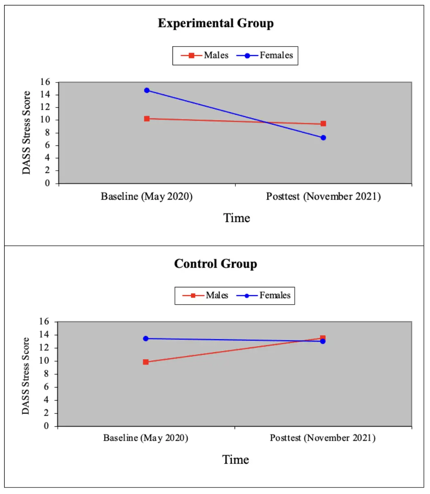

I wrote this paper, "Designing a Stress Management Intervention for Students at City College," for a first-year undergraduate psychology course from Fall 2023 at City College. The professor asked us to review a [paper by López-Castro, Brandt, Anthonipillai, Espinosa, and Melara (2021)](https://journals.plos.org/plosone/article?id=10.1371/journal.pone.0249768) that looked at the impact of COVID-19 on City College Students. We then had to propose a stress management intervention. I have displayed my response below.

**Designing a Stress Management Intervention for Students at City College**

**Introduction**

The COVID epidemic during the New York City lockdown revealed three distinct effects on CCNY students' infection history as they reported them. Firstly, a notable gender disparity emerged in the severity of cases: a higher number of women described experiencing serious infections and hospitalizations. Secondly, though the overall infection rate among students was low, those who did contract the virus described it as particularly severe, often leading to hospitalizations. Thirdly, across the complete range of COVID experiences, from asymptomatic to severe, the overall impact, as characterized by students, was statistically consistent across genders and ethnic/racial groups. This suggests that while women and possibly some ethnic/racial groups described experiencing more severe cases, the general burden of COVID, encompassing milder cases as well, was evenly spread across all student demographics in this cohort.

CCNY students reported being negatively impacted at home and work due to COVID and lockdown. Home life impacts included more verbal arguments, increased caregiving, and taking over child instruction. Work life impacts included, difficulties in transitioning from work to home, increase in workload and a reduction in work hours or being furloughed. Despite these negative impacts, participants also described positive effects of lockdown, including increased appreciation of things normally taken for granted, more quality time with family or friends and increased attention paid to personal health.

Gender differences were evident in the impacts experienced during the epidemic. Women generally indicated greater negative effects than men. For instance, women experienced more disruptions to their social activities, including reduced time for hobbies, canceled celebrations, and separation from loved ones. In domestic settings, women faced more challenges, such as heightened verbal conflicts and increased responsibilities for caregiving and teaching family members. They also noted greater impacts on their emotional health, with more screen time, reduced sleep quality, and deteriorating mental health. Notably, however, women also described experiencing more positive effects, such as a heightened appreciation for life, improved quality time with loved ones, and a stronger focus on personal health.

We hypothesize that a stress management treatment implemented and administered to CCNY students will deliver significant improvements in mental health and will mitigate the negative impacts identified and associated with COVID and lockdown.

**Methods**

Participants for our study will include CCNY students who volunteer in response to recruitment efforts. Our target population is the broader CCNY college student body. Participants will be selected via school wide broadcast emails to the CCNY subject pool and offering of course credit and the potential of winning one of two $500 gift cards in a raffle. Our target population will be sampled with convenience sampling, selecting those who respond to our outreach, rather than random sampling from the entire student population. We will use convenience sampling to align with the methods used in previous research, facilitating comparison with established baselines. After our convenience sampling we will apply stratification in order to add further controls. To assess the baseline effects of COVID on stress we will conduct pre-intervention measurements. These pre-intervention measurements will include sociodemographic information and the depression, anxiety and stress scales (DASS). These pre-intervention measurements will replicate the design of previous research, with any extensions as needed. Using this approach, both our pre-intervention measurements and previous research may be used as baseline. We plan to test two groups, experimental and control. We plan to obtain 150 to 200 individuals per group. We plan to use stratified random assignment to assign individuals to groups, allowing us to mitigate selection bias and enhance the internal validity of the study findings. Due to the large number of participants we believe stratified random assignment will offer suitable control for confounding variables.

Experimental group treatment will consist of a seminar on stress management techniques conducted by trained counselors at CCNY. Control participants will be offered waitlist treatment as intervention. In order to address concerns regarding spontaneous changes in stress we will measure both groups, with repeated measures of DASS, pre-intervention (baseline) and post-test, after treatment intervention. We will capture baseline socio-demographic information via a survey administered pre-intervention, survey measurements will inform us of gender, and current infection history. Pre-intervention DASS will establish baseline depression. We will use stratified random assignment with our baseline data to control for differences in gender, infection history and depression between groups. Two other variables we will control for will be ethnicity and death of a loved one due to COVID. We would use the same socio-demographic survey and stratified random assignment to control for these.

Our dependent variable, “DASS stress score,” will be operationally defined as the stress component measurement of the DASS scale (0-14, Normal; 15-18, Mild; 19-25, Moderate; 26-33, Severe; 34+, Extremely Severe). We'll collect academic grades pre- and post-intervention to assess impact. In order to determine how stress management training correlates with academic performance, we will run a correlation between average stress level and academic performance for the semester to see if lower stress correlates to better grades.

Our independent variable is “Stress Management Seminar,”with levels of “Administered” (for the experimental group who receive the seminar) or “Not Administered” (for the control group who do not receive the seminar immediately). We will control for gender, infection history, depression, ethnicity and death of a loved one.

**Results**

We would use a 2 x 2 x 2 mixed-design ANOVA (three-way ANOVA), for our study, which incorporates between-subjects factors (Group: Experimental vs. Control; Gender: Male vs. Female) and a within-subjects factor (Time: Baseline vs. Posttest). This analyzes interactions and effects of treatment, gender, and time on stress. The difference between the experimental and control groups would be evaluated by examining the Group x Time interaction effect in the ANOVA, focusing on how mean stress scores change from baseline to posttest between these groups.

To calculate the variation within the experimental and control groups, we would separately assess the variance of stress scores for each subgroup defined by gender and time point. For each subgroup—such as male participants in the experimental group at baseline—we would calculate the sum of squares by subtracting each participant's stress score from the subgroup's mean stress score, squaring these differences, and summing them up. This sum would then be divided by the degrees of freedom, which is the count of participants in the subgroup minus one. The resulting variance provides a measure of how much individual stress scores in each subgroup deviate from their respective subgroup mean. Variance is calculated for each subgroup—male and female, baseline and posttest, experimental and control.

Statistical significance refers to the likelihood that the differences observed between our experimental and control groups occurred due to chance. In our ANOVA analysis, we will obtain an F-value for each of these groups, representing the ratio of variability between the experimental and control groups to variability within each group. At the outset of our experiment, we typically set a significance level (alpha value), often chosen as 0.05. Using the F-value, alpha level, and degrees of freedom, we calculate the p-value. This p-value signifies the probability of obtaining an F-value as extreme as, or more extreme than, the one we observed. Subsequently, we can assess whether the difference between the experimental and control groups is statistically significant based on this p-value. If the p-value is less than our alpha level of 0.05, we conclude that the difference between the experimental and control groups is statistically significant.

**Conclusions**

*Dr. Nishanthi’s graphs.*

Dr. Nishanthi’s graphs show a decrease in stress scores for both genders in the experimental group, with females benefiting slightly more than males. In contrast, the control group shows an increase in stress for males and a negligible change for females. This suggests that the stress management training may reduce stress, particularly in females. However, the varied gender and group responses suggest one intervention may not uniformly reduce stress. Other individual and contextual factors may also play a role. Additional data is required to determine the significance of these findings.

The increase in stress levels, seen in males in the control group, might be attributed to a bio-psycho-social interplay. Biologically, hormonal differences, such as higher testosterone levels, can influence stress response and recovery. Psychologically, men may have different stress appraisal, with a tendency towards problem-focused coping that might not mitigate stress when the situation is beyond control. Socially, the cultural expectation for men to be providers could have been exacerbated during the pandemic's economic impact, which hit male-dominated industries hard. These factors, along with gender differences in reported pandemic impacts—women reporting higher impacts in baseline research—offer a multi-faceted explanation and underscore the need for targeted interventions.

One explanation for the differing impacts of stress management training on males versus females may relate to societal attitudes towards mental health. Men often face a stigma around seeking help, perceived as 'unmanly' or vulnerable, conflicting with traditional masculinity. This cultural barrier may lead to men being less open during training, potentially underreporting their stress levels, and being hesitant to fully engage with or implement the stress management techniques offered. Conversely, women typically report emotional states more freely and may utilize social support as a coping mechanism, making them more receptive to such interventions.

To improve Dr. Nishanthi’s study, two primary enhancements are recommended. Firstly, diversifying the stress management strategies would likely increase the study's effectiveness. A variety of interventions, such as cognitive-behavioral techniques, mindfulness practices, and physical activities, could be introduced to cater to diverse student needs and preferences, likely improving outcomes for both genders. Secondly, implementing a longitudinal design would provide valuable insights into the long-term efficacy of these interventions. By monitoring stress levels and academic performance over a prolonged period, the study could yield a more comprehensive understanding of the enduring impact of these stress management strategies on student well-being.
