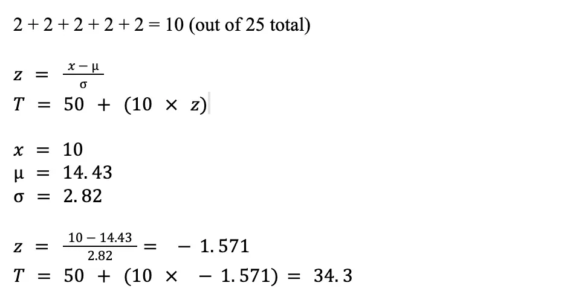
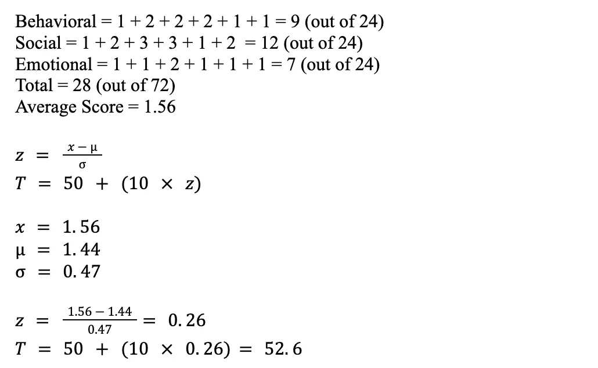
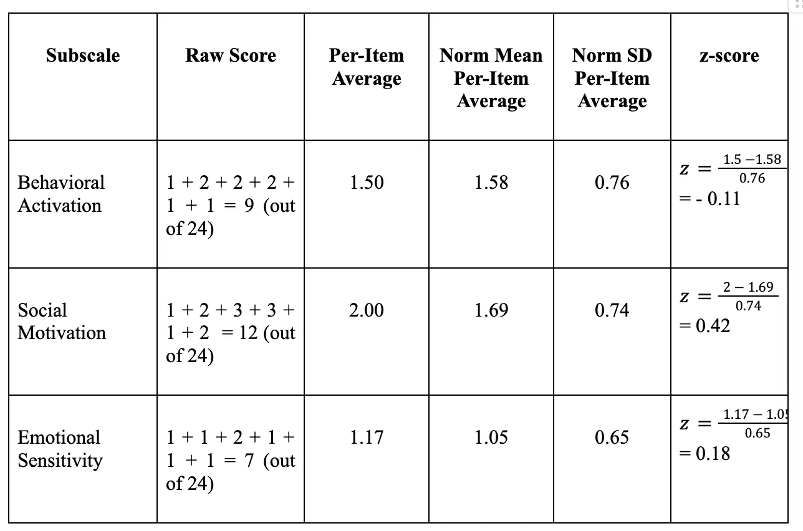
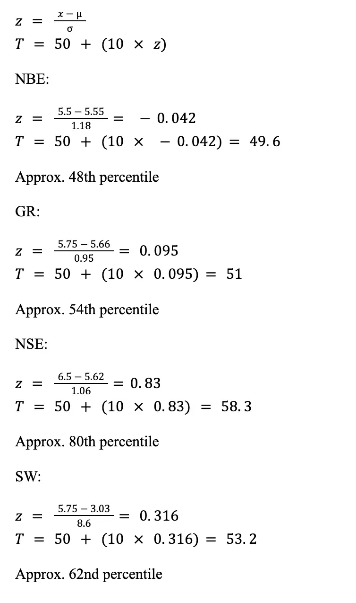
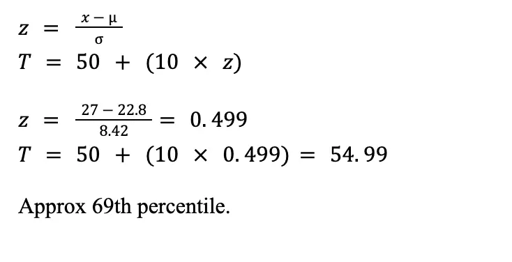
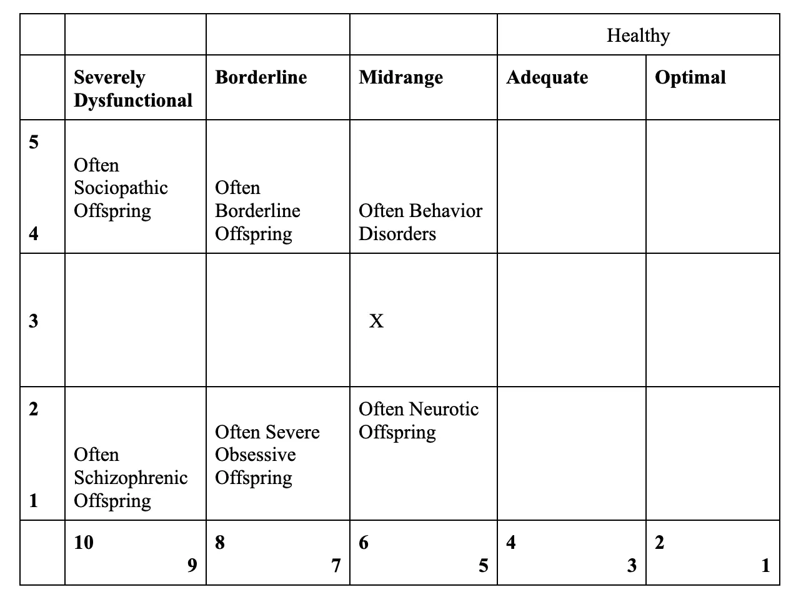
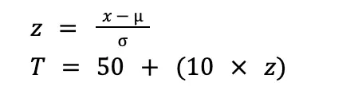
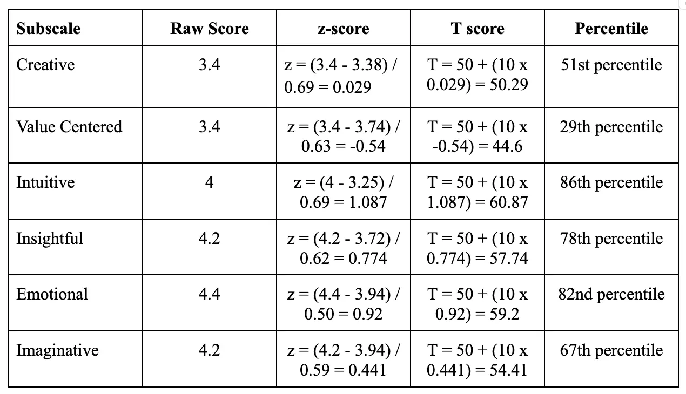
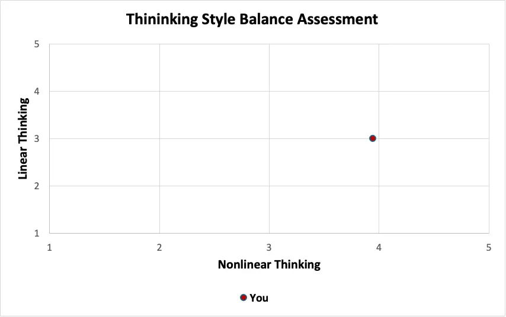

I wrote this psychological evaluation report for our assessments class at the University of Rochester. The professor asked us to use take random and anonymous surveys with our classmates and then create a fictional character to report the results as. I have included my psych report below.

### Lana’s Psych Report (Fictional)

**PSYCHOLOGICAL EVALUATION**

*-CONFIDENTIAL-*

**NAME:** Lana **GENDER**: Female

**DOB**: 06/21/1985 **CA**: 39 years, 10 months

**REFERRAL SOURCE**: Self **DOE**: 04/01/25, 04/07/25, 04/28/25, 05/02/25

**PRIMARY LANGUAGE**: English **EXAMINER**: Ryan Bohman

#### **REASON FOR REFERRAL:**

Lana was self-referred for psychological assessment after experiencing fatigue, depression, attachment anxiety, and existential angst. She is currently working as a singer-songwriter and performer and managing the business aspects of her career. Lana has often been able to channel creative ideas into her art. Still, she recently reports feeling emotionally depleted, uninspired, and lacking motivation. Lana shares that many people in her life fail to understand her for who she truly is. Additionally, she expresses guilt over being unable to produce new material, particularly given the number of people who rely on her. This evaluation report aims to assess Lana's overall well-being, motivation, guilt and shame proneness, stress reactivity, family attachment, and cognitive-emotional thinking styles and synthesize results with her clinical interview, mental status exam, and clinical history.

#### **ASSESSMENT TECHNIQUES:**

Clinical Interview

Mental Status Examination (MSE)

WHO (Five) Well-Being Index (WHO–5)

Apathy Motivation Index (AMI)

Guilt and Shame Proneness Scale (GASP)

Perceived Stress Reactivity Scale (PSRS)

Self-Report Family Inventory (SFI)

Linear/Nonlinear Thinking Style Profile (LNTSP)

#### **BACKGROUND INFORMATION:**

Lana is a 39-year-old who identifies as a Caucasian female. Lana was born in New York City and raised in Lake Placid, a small town in upstate New York. She is best known for her career as an award-winning singer-songwriter and has released nine studio albums. She is preparing to release her tenth studio album and is gearing up for worldwide performances. As a teenager, Lana experienced a substance use disorder; her parents sent her to a Christian boarding school in Connecticut at the age of 14. She later left school to attend rehab and has maintained sobriety since 2003. Lana initially enrolled at SUNY Geneseo before taking a gap year. She later transferred to Fordham University, where she studied philosophy with a focus on metaphysics. Her music career began shortly after university, developing her talent while living with her aunt and uncle in Long Island and working as a waitress.

Lana grew up in a relatively strict, upper-middle-class household in upstate New York. Her parents worked for a global advertising and marketing company in New York City before moving to Lake Placid when Lana was one year old. There, her father worked for a furniture company and later became involved with internet domains, while her mother worked as a school teacher. Lana is the eldest of three siblings, with a younger sister, Caroline, and a brother, Charles. Lana shares a close bond with her siblings and has collaborated with them in business.

Lana describes a complex relationship with her parents, noting a close bond with her father, who was more relaxed and creative. She even collaborated on music with him. In contrast, she has spoken of a strained relationship with her mother, who she describes as emotionally abusive and a strict disciplinarian. Lana cites her mother as a major source of trauma and part of the reason she turned to substance use, as well as the spark behind her later philosophical questioning, including grappling with the meaning of life in the face of death. Lana has also expressed feelings of guilt about not yet being a mother. In 2024, she married her partner, Jeremy Dufrene, whom she met in 2019 and works in tourism. Lana shared that her father walked her down the aisle, and her siblings were present at the wedding, although her mother was absent. Lana is a deeply spiritual person. She was raised Catholic and became more interested in God during her teenage years while struggling with substance use and attending a Christian boarding school. This experience eventually led her to study philosophy. Today, she describes having an open relationship with religion, embracing the parts that resonate with her and letting go of the rest.

Lana believes she strives to live a healthy life. Being sober and a performer, she focuses on maintaining her physical well-being. Lana exercises about three times a week with a personal trainer. Despite feeling physically healthy, she reports a lack of motivation and a noticeable dip in her usual creativity. Lana also finds herself sleeping in more than usual. Lana reports no prior history of mental illness aside from her teenage years, stating she hasn't felt this depressed since that time. She shares that she has had difficulties in past romantic relationships, but since her recent marriage, she feels both happiness and a kind of grief. Lana attributes these complex feelings to turning 40 and the emotional weight of entering a new life chapter. She also expresses sadness about not yet having children.

#### **INTERVIEW:**

During an informal interview conducted before the assessments beginning on 04/01/25, Lana reported feeling a kind of "summertime sadness". That even though her life was going so well, with career success and a recent marriage, something was bringing her down. While Lana loves her career and creating art through her singing and songwriting, she feels a lack of existential meaning that she has never felt so strongly. Lana said that the relationships in her life that used to bring her joy now feel inauthentic and draining. Lana believes these inauthentic relationships have led to her lack of inspiration and low creative output. Lana worries that if she continues to feel this way, she will let those around her down, and she worries that those around her will not love her when she is no longer "young and beautiful." Lana shared that playing with her husband's children from a previous relationship has awakened something in her. She is also facing considerable stress in her career right now, with the finalization of her new album. Lana reports a changed sleep schedule and strange dreams. Specifically, one dream where her mother appears to her in the desert under a tree, which she believes is a Myrrh tree. In the dream, her mother screams, "My eyes," while pushing her fingers into her eye sockets as blood streams out. At that moment, water begins flowing and turns the desert into a lush garden, with trees emerging full of fruit. Lana hopes to discover what makes her feel this way to regain her creative spark and move forward in her new life.

#### **BEHAVIORAL OBSERVATIONS:**

Lana willingly accompanied the clinician to testing on 04/01/25, 04/07/25, 04/28/25, and 05/02/25. She was friendly but slightly distant when speaking with the clinician. The clinician established rapport when they discovered shared interests in Leonard Cohen and Vladimir Nabokov. Lana was slow to answer during the initial assessments but became more engaged toward the end, with her responses growing increasingly creative and elaborate. She remained mostly stationary, with slow movements and a drifting gaze. Occasionally, she would lift her leg and switch the crossing of her legs, sighing as she did. Lana reported that she was not hungry or thirsty, and she desired nothing. She remained quiet throughout the process but looked the clinician deeply in the eye at the end and asked, "Did I do a good job?" Between assessments, she sat silently in her chair, staring at the wall. Lana reported that the environment in the assessment room was "fine" but that many of the questions felt pointless. "We're going to die anyway, we're born to die," she said.

#### **MSE:**

Lana arrived at the session about 15 minutes late, claiming she got lost on the way. She appeared to be around 5'7" tall and slim to average weight, around 150 lbs, with a curvy yet slender figure. Lana appeared very well groomed and stylishly dressed, with a sensual vintage allure. She was sporting a champagne-toned dress with soft, elegant weaves and delicate sequins. The dress plunged into a low-cut neckline framing her bosom, paired with a sheer, gossamer shawl draped loosely over her shoulders. The fabric was gentle and flowing, giving an ephemeral quality, falling from top to just below her knees, drawing attention to her sturdy calves, further accentuated by matching nude strappy heels. She carried a classic vintage-style clutch. Lana styled her auburn hair in a retro beehive adorned with delicate embellishments, and her makeup was classically glamorous. Defined eyes, long lashes, contoured cheeks, and deep, glossy cherry-red lips. Her movements were slow and purposeful. While seated, she remained mostly still, with a drifting gaze often fixed on the floor, wall, or out the window. Eye contact was infrequent but meaningful. Lana was polite, though carried a distant, slightly aloof air. Her speech was soft and slow, marked by thoughtful pauses, as though each word passed through a filter of contemplation. Her affect was consistent with her reported mood, subdued, pensive, and emotionally restrained. She was oriented to person, place, and time (Ox3). Her thought process was deeply reflective and creative: she stayed on topic but often branched into metaphor or poetic associations that remained relevant. Lana denied any major changes in appetite but described notable shifts in her sleep patterns, including increased fatigue, unusual dreams, and sleeping more than usual. She stated she exercises three times a week with a personal trainer. She remained attentive throughout the session, with appropriate concentration and an accurate perception of her surroundings. Her judgment, impulse control, memory, and capacity for abstraction appeared within normal limits. She denied any suicidal ideation, homicidal thoughts, or active hallucinations. She also denied phobias, obsessive thoughts, or delusional beliefs.

#### **ASSESSMENT RESULTS AND ANALYSIS:**

*The assessment measures utilized are valid for Lana as they measure what they purport to measure rather than any impairment in sensory, manual, speaking skills, or cultural/linguistic characteristics. The results of the assessments should be interpreted with caution as the scores may be affected by fatigue, agitation, and uncomfortable positioning, despite Lana’s effort and concentration.*

#### ***WHO (Five) Well-Being Index (WHO–5) (1988 version)***

The WHO (Five) Well-Being Index (WHO-5) was administered to Lana on 04/07/25. The WHO-5, originally designed to measure well-being, is also used as a screening tool for depression (Sischka et al., 2020). The WHO-5 consists of five questions and takes less than one minute to administer; it assesses an individual over the last two-week period. For each question, the individual may respond on a six-point Likert scale ranging from 0 = "at no time" to 5 = "all of the time." The resulting raw scores may vary from 0 to 25, with 0 representing the lowest well-being, 25 representing the highest well-being, and a score below 13 indicating poor well-being and cause for further assessment for depression. The WHO-5 is normed on a dataset from 43,469 individuals participating in the workforce, aged between 15-65, from 35 different European countries with balanced gender representation and is considered valid and reliable, with a mean of 14.43 and a standard deviation of 2.82 for the norming sample. The WHO-5 is an appropriate instrument to use with Lana to efficiently screen for depression as well as assess her overall well-being.

Lana’s scores were:

Lana scored a total of 10 on the WHO-5 (with each of her responses rated a 2), which corresponds to a z-score of -1.571 (or a T-score of 34.3), indicating her score is 1.571 standard deviations below the mean. Lana is placed in approximately the 5.81st percentile, meaning her level of well-being is lower than about 94% of individuals in the reference group. Additionally, her score falls below the instrument's clinical cut-off of 13, suggesting the need for further screening for depression.

#### ***Apathy Motivation Index (AMI)***

The Apathy Motivation Index (AMI) was administered to Lana on 04/07/25. The AMI is designed to measure different dimensions of apathy. It consists of 18 questions, each of which is answered on a five-point Likert scale, ranging from 0 ("Completely Untrue") to 4 ("Completely True"), resulting in a raw score between 0 and 72, with a higher score considered more apathy (Ang, Lockwood, Apps, Muhammed, & Husain, 2017). Research proposes cut-offs for moderate apathy to be greater than 1 standard deviation from the norm mean and severe apathy to be greater than two standard deviations from the norm mean. Researchers designed the AMI to capture apathy and motivation across three dimensions: Behavioral Activation (BA), Social Motivation (SM), and Emotional Sensitivity (ES). The AMI was normed on two large samples of healthy adults, first with an exploratory factor analysis (EFA) with 505 individuals aged between 16-85, and second with a confirmatory factor analysis (CFA) with 479 individuals aged 18-74. Both samples included male and female participants from diverse backgrounds. The AMI is considered valid with strong correlations to other existing measures, reliable with high test-retest reliability, and has a mean of 1.44 and standard deviation of 0.47. The AMI is an appropriate instrument to use with Lana to assess her reports of lack of motivation.

Lana’s scores were:

Lana scored 28 (out of 72) on the AMI, with an average score of 1.56, which converts to a z-score of 0.26 (or a T score of 52.6), indicating her score is roughly 0.26 standard deviations above the mean. This result places her in approximately the 60.26th percentile meaning that she has lower motivation than roughly 40% of individuals in the reference group. Her score does not fall within the cut-off range of either 1 or 2 standard deviations away from the mean, so whilst she does have lower motivation, according to the AMI measurement, it is not yet severe or even moderate. Lana received dimensional scores of 9 (out of 24) for behavioral, 12 (out of 24) for social, and 7 (out of 24) for emotional. To place the dimensions in context we can find z-scores for each dimension, it is important to note that the dimensional scores were normed on a different data set than the total scores, and their means and standard deviations were calculated by per-item averages as shown below:

Lana's Behavioral Activation score is slightly below average (z = -0.11), suggesting a mild reduction in self-initiated activity. Her Social Motivation score is slightly above average (z = 0.42), indicating relatively intact or even enhanced interest in social engagement. Her Emotional Sensitivity is also slightly above average (z = 0.18), reflecting typical or heightened emotional responsiveness. While her total AMI score is above average, her dimensional scores reveal a more nuanced picture: only her behavioral apathy is slightly reduced, whereas her social and emotional motivation remains intact or slightly elevated.

#### ***Guilt and Shame Proneness Scale (GASP)***

The Guilt and Shame Proneness Scale (GASP) was administered to Lana on 04/07/25. The GASP individual differences in the propensity to experience guilt and shame. It consists of 16 questions, each of which is answered on a seven-point Likert scale, ranging from 1 ("Very Unlikely") to 7 ("Very Likely"). The GASP is scored by averaging the four items in each subscale. The four subscales are, Guilt-Negative-Behavior-Evaluation (NBE), Guilt-Repair (GR), Shame-Negative-Self-Evaluation (NSE), Shame-Withdraw (SW) (Cohen, Wolf, Panter, & Insko, 2011). The GASP was normed in two studies, the first on 728 students in North Carolina, of mixed gender but predominantly white. A second study was done on 385 students with a similar composition. The GASP was validated, and it is specifically designed to isolate measurements of guilt and shame. Each GASP subscale shows acceptable reliability. The AMI is an appropriate instrument to use with Lana to assess her reports of guilt over being unable to produce new material.

Lana’s scores were:

NBE: 4 + 6 + 7 + 5 = 22, 22/4 = 5.5

GR: 6 + 4 + 6 + 7 = 23, 23/4 = 5.75

NSE: 6 + 7 + 7 + 6 = 26, 26/4 = 6.5

SW: 7 + 4 + 7 + 5 = 23, 23/4 = 5.75

From our norming sample we are given:

NBE, M = 5.55, SD = 1.18

GR, M = 5.66, SD = 0.95

NSE, M = 5.62, SD = 1.06

SW, M = 3.03, SD = 8.6

Lana scored an average of 5.5 (out of 7) on Guilt-Negative-Behavior-Evaluation (NBE) which results in z-score of -0.042 and a T score of 49.6, placing her in approximately the 48th percentile, or the top 52% of people. Lana scored an average of 5.75 (out of 7) on Guilt-Repair (GR), which results in a z-score of 0.095 and a T score of 51, placing her in approximately the 54th percentile, or the top 46% of people. Lana scored an average of 6.5 (out of 7) on Shame-Negative-Self-Evaluation (NSE), resulting in a z-score of 0.83 and a T score of 58.3, placing her approximately in the 80th percentile or in the top 20% of people. Lana scored an average of 5.75 (out of 7) on Shame-Withdraw (SW), resulting in a z-score of 0.316 and a T score of 53.2, placing her approximately in the 62nd percentile, or the top 38% of people. None of these scores rated her statistically significant, with the Shame-Negative-Self-Evaluation (NSW) showing slight elevation but also not statistically significant. Results indicate that Lana experiences guilt and shame in a typical way when compared to the reference population, with the potential that she may have slightly elevated negative self-elevation when she feels shame.

#### ***Perceived Stress Reactivity Scale (PSRS)***

The Perceived Stress Reactivity Scale (PSRS) was administered to Lana on 04/28/25. The PSRS is a 23-item questionnaire with five subscales and one overall scale that measures perceived stress reactivity. The 5 subscales are, Prolonged Reactivity (PrR), Reactivity to Work Overload (RWO), Reactivity to Social Conflict (RSC), Reactivity to Failure (RFa), Reactivity to Social Evaluation (RSE). Each question is scored on a three-point Likert scale from 0 to 2 points per question, giving a total raw score of 0 to 46 (Schlotz et al., 2011). The PSRS was normed over three studies with a total of 2040 participants, aged 17-86, across multiple countries, Germany, the United Kingdom, and the US. Samples included a mix of genders and ethnic backgrounds. The instrument was validated successfully and cross-culturally validated and found to have moderate to high test-retest reliability. The PSRS has a total score mean of 22.8 and a standard deviation of 8.42. The PSRS is an appropriate instrument to use with Lana to see if the stress of her work schedule is affecting her.

Lana’s scores were:

Standard Score, 0,1,2

Reversed Score (Q’s 2,10,20,5,17,19,8,13,15,18,11,22) Scoring, 2,1,0

Totals: 1+2+2+2+1+0+1+1+1+1+2+1+1+1+1+1+1+1+1+1+1+2+1 = 27

Lana scored a total of 27 on the PSRS, which corresponds to a z-score of 0.499 (or a T-score of 54.99), indicating her score is around 0.5 standard deviations above the mean. This places her in approximately the 69th percentile, meaning her perceived reactivity to stress in the top 31% of individuals in the reference group. Whilst her store is not statistically significantly above average, it is still slightly above average.

#### ***Self-Report Family Inventory (SFI)***

The Self-Report Family Inventory (SFI) Stress Reactivity Scale (PSRS) was administered to Lana on 05/02/25. The SFI is a 36-item questionnaire, with each question response being a five-point Likert scale ranging from 1 = "YES: Fits our family very well" to 5 = "NO: Does not fit our family". The raw scores are calculated using a scoring sheet, some in normal order and some in reverse order. SFI contains five subscales: Health/Competence, Cohesion, Conflict, Leadership, and Expressiveness. In order to interpret the scores, we have converted the Health/Competence score to an Observation Competence Score Equivalent (OCSE), converted the Cohesion score to an SFI Scale Average, and plotted these converted scores on the Family Assessment Schema diagram below. The SFI is an appropriate instrument for Lana, considering her reports of tumultuous family system attachments, especially with her mother.

Lana’s scores were:

Health/Competence = 2+4+4+3+3+4+3+3+4+3+3+3+2+2+3+4+3+3+4 = 60

Converts to OCSE = ~6 (x axis in table below)

Cohesion = 2+4+3+3+4 = 16

Converts to SFI Scale = ~3 (y axis in table below)

**Table 1 Lana’s Family Assessment Schema**

Lana's score places her in the Midrange and Mixed quadrant of the Family Assessment Schema. These scores indicate that her family had relatively clear communication. Her family members (typically parents) may have been controlling, with a narrative that "loving means controlling." As a reaction to the controlling environment, family members may have distanced themselves, developed anxiety, depression, or expressed anger. When the family experienced conflicted emotions, they would not likely be addressed directly but instead handled by repression. As a result of these family dynamics the report indicates that Lana may be equally susceptible to behavioral disorder and neuroticism.

#### ***Linear/Nonlinear Thinking Style Profile (LNTSP)***

The Linear/Nonlinear Thinking Style Profile (LNTSP) was administered to Lana on 05/02/25. The LNTSP is a tool designed to see how an individual processes information and solves problems. The LNTSP consists of 40 questions; for each question, the individual may respond on a five-point Likert scale ranging from 1 = "Strongly Disagree" to 5 = "Strongly Agree". The resulting raw scores may vary from 40 to 200, although scores are interpreted across seven dimensional subscales, Creative (M = 3.38, SD = .69), Values Centered: (M = 3.74 SD = .63), Imaginative (M = 3.94, SD =.59), Intuitive (M = 3.25, SD = .69), Flexible (M = 3.92, SD = .56), Insightful (M = 3.72, SD = .62), Emotional (M = 3.94, SD = .50). The instrument was normed across three studies with an overall sample size of N = 778, comprising business students and managers, in US, approximately 18-65 years of age, mixed gender and predominantly Caucasians. The instrument has demonstrated strong reliability and construct validity supported by exploratory and confirmatory factor analyses.

Lana’s scores were:

Linear = 3.0

Nonlinear = 3.94

Overall Thinking Style Score = -0.94

Lana's results on the LNTSP indicate a clear preference for nonlinear thinking over linear thinking, with an overall nonlinear average of 3.94 compared to a linear thinking average of 3.0, producing a difference score of -0.94. It is helpful to examine Lana's scores across the subscales. Lana's most dominant thinking styles are Intuitive (86th percentile and statistically significant), Emotional (82nd percentile), and Insightful (78th percentile). Her use of lyrical poetry and emotionally evocative themes in her musical artistry may reflect these tendencies. She also demonstrates moderately high Imaginative thinking (67th percentile) and about average Creative thinking (51st percentile), suggesting a strong capacity for novel ideas and internal visualization. Lana scored below average on the Value-Centered dimension (29th percentile), which suggests she tends to respond more to immediate feelings and emotional cues than to fixed personal or ethical value frameworks when making decisions or expressing herself.

#### **SUMMARY:**

This psychological evaluation synthesizes data from Lana's clinical interview, mental status exam, and six standardized assessments to evaluate concerns about mood, motivation, stress reactivity, family dynamics, and cognitive-emotional processing.

Findings indicate that Lana is currently experiencing markedly reduced well-being, with a WHO-5 T-score of 34.3, placing her in the lowest 6th percentile, suggesting a risk for a depressive episode. Her overall apathy level, assessed via the Apathy Motivation Index (AMI), was slightly elevated (T = 52.6), with mild reductions, specifically in behavioral activation. However, emotional and social motivation remains intact. This pattern may reflect a temporary drop in functioning from a typically high motivational baseline, consistent with her self-described history of intense creative drive.

Lana’s Guilt and Shame Proneness Scale (GASP) scores fall within normative ranges, though her Shame–Negative Self-Evaluation score was modestly elevated (T = 58.3), suggesting a tendency toward internalized self-criticism. Stress reactivity scores from the PSRS also exceeded the normative mean (T = 54.99), confirming her self-reported difficulties coping with occupational and interpersonal stress.

Family dynamics assessed via the SFI place her in a Midrange/Mixed quadrant, often associated with emotionally repressive, control-driven environments. Her nonlinear thinking style is strongly characterized by intuitive, emotional, and imaginative processing, further reflected in dream content, symbolic reasoning, and emotional expression during clinical interactions. Together, these findings suggest that Lana's distress may stem from unresolved relational trauma, existential questioning, and disrupted meaning-making, factors directly impacting her creativity, emotional regulation, and professional engagement.

#### **RECOMMENDATIONS:**

Based on these we make the following recommendations:

1. **Psychodynamic Therapy with Existential Focus (12 weeks+)**

We recommend a referral to a psychodynamic therapist with existential training to begin assessment and treatment for depression. This approach is appropriate for Lana given her intuitive thinking style, emotional depth, and artistic expression. A psychodynamic therapist can explore childhood experiences, assess attachment patterns and trauma history, and incorporate dream analysis and relational work to address Lana’s reported interpersonal difficulties. Emotion-focused techniques may be used to help access repressed emotions, particularly those stemming from early family dynamics. An existentially oriented clinician may also resonate with Lana’s philosophical and metaphysical interests and help her re-engage with a sense of meaning and creative vitality.

1. **Mindfulness-Based Stress Reduction (MBSR) Program (6–8 weeks)**

We recommend Lana to a mindfulness and stress reduction group to practice mindfulness techniques such as meditation and breathing, along with practical behavioral techniques to aid in stress and crisis management.

1. **Medical Referral for Sleep Study**

Due to significant fatigue, altered sleep patterns, and recurring vivid dreams, a referral to a sleep specialist is advised. A comprehensive sleep evaluation may help rule out physiological contributors such as hypersomnia, sleep disorders, or circadian rhythm disturbances that could be impacting Lana’s overall well-being.

1. **Optional: Couples or Family Therapy (3–6 sessions)**

Considering Lana’s expression of relationship difficulties and family trauma, we have also provided a referral to a family systems and couples therapist. This therapist may be able to conduct group sessions with Lana’s closest family members to improve her marriage or family system by providing support around communication, emotional processing, and role dynamics. This may be particularly helpful as Lana transitions into midlife and considers starting a family herself.
