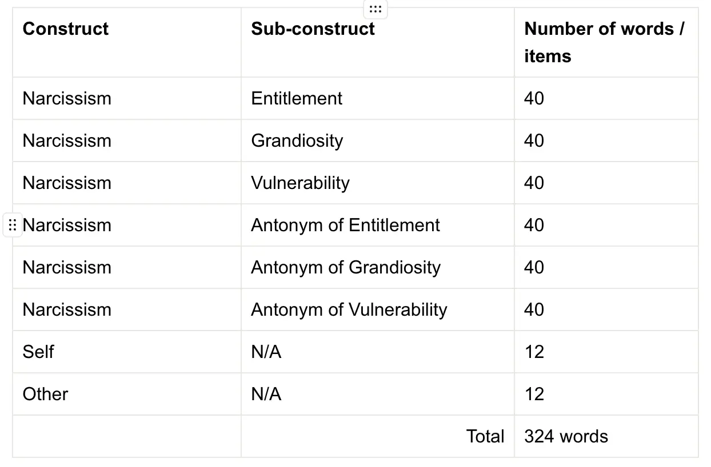
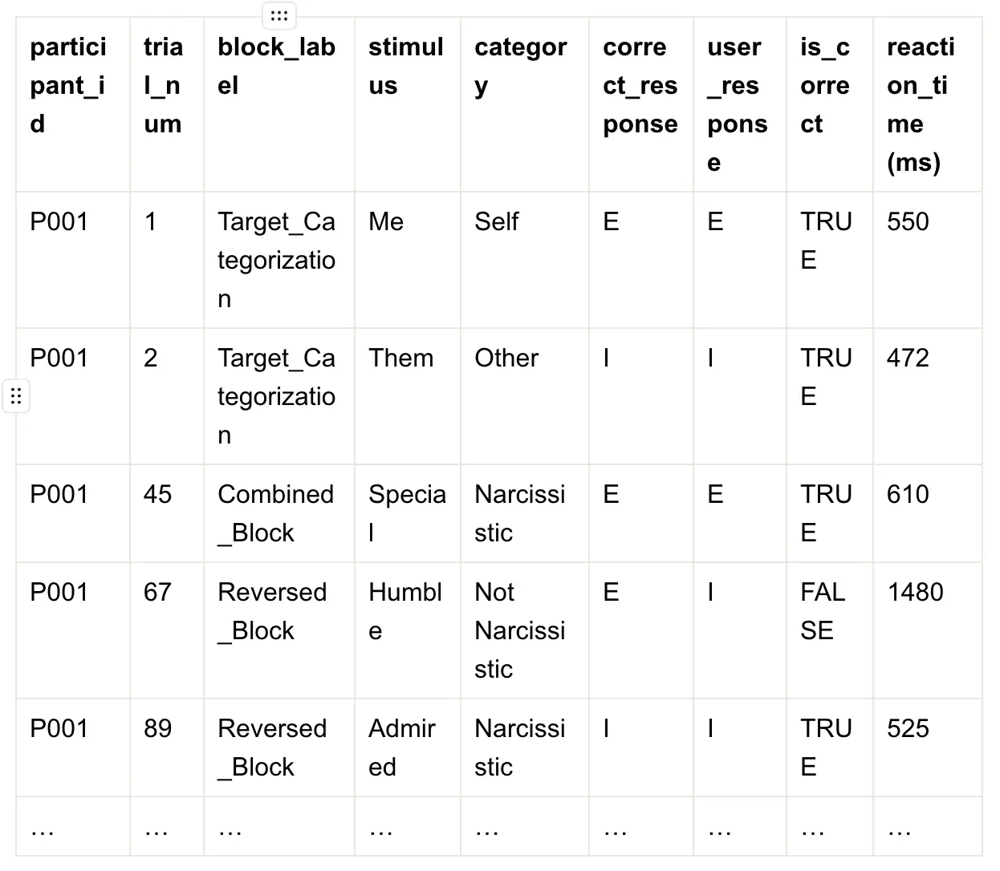
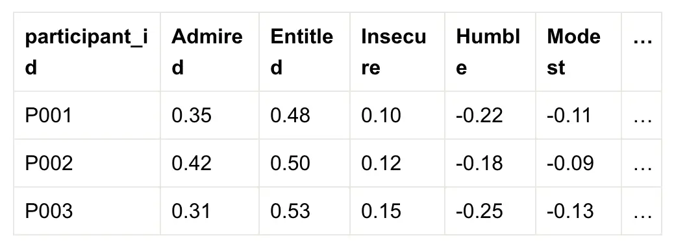
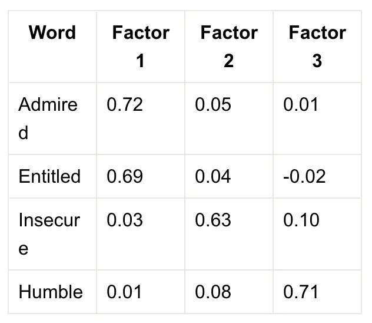
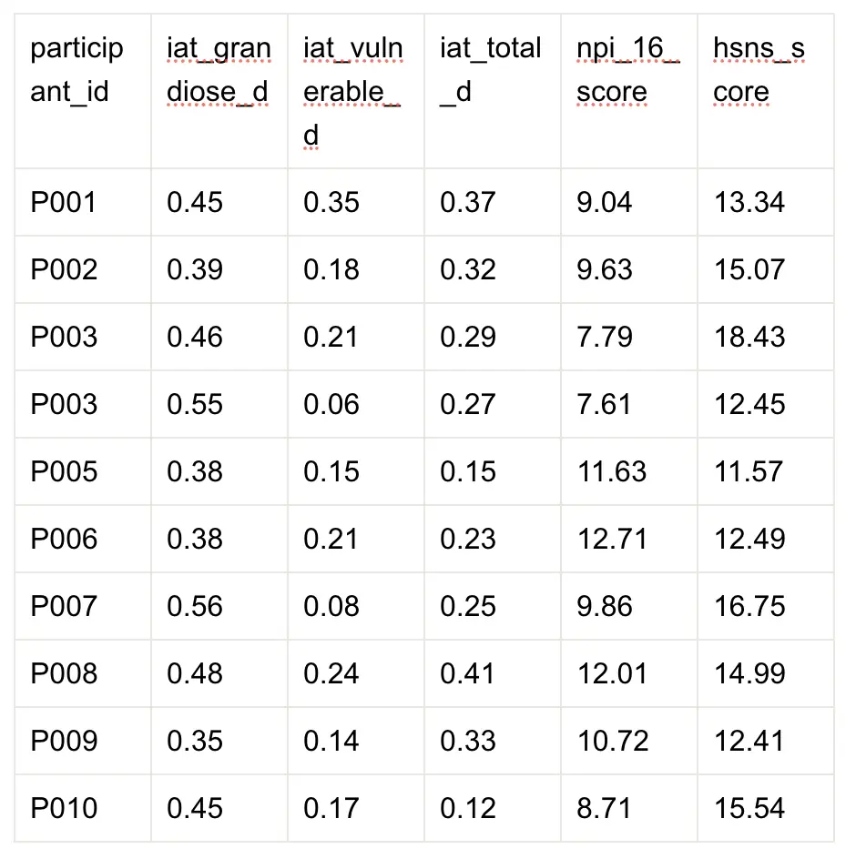
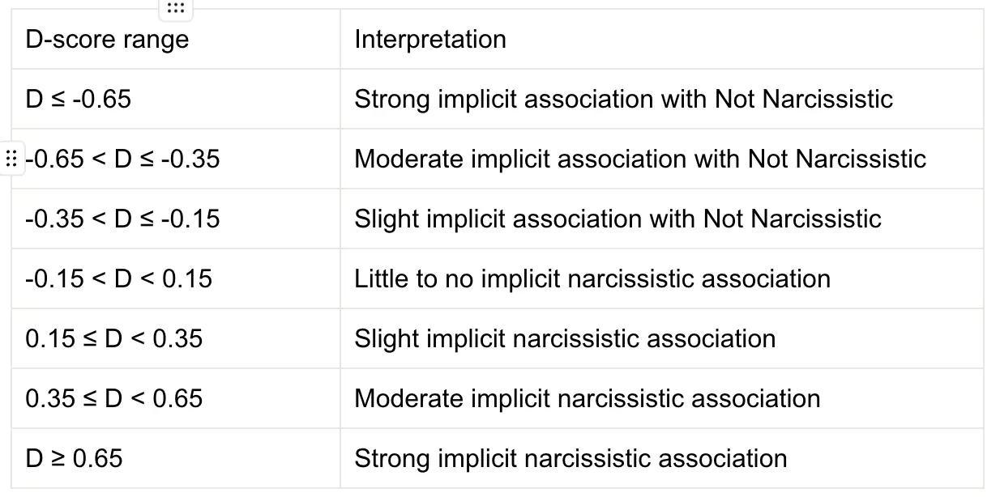

I created this proposal for a new instrument to measure narcissism for our assessments class at the University of Rochester.

### Implicit Association Test Instrument for Narcissism (IAT-Narc)

#### **Abstract**

Narcissism is a psychological construct of growing interest, yet most existing assessments rely on self-report instruments that are prone to social desirability bias and lack comprehensive construct validity. The present study introduces the Implicit Association Test for Narcissism (IAT-Narc), a novel instrument designed to assess unconscious narcissistic traits using reaction-time tasks. By leveraging the Implicit Association Test methodology (Greenwald et al., 2017) and adopting the triarchic model of narcissism (Wright & Edershile, 2017), which includes grandiosity, entitlement, and vulnerability, IAT-Narc aims to overcome the limitations of traditional explicit measures. This paper outlines the development of IAT-Narc and a four-phase empirical validation process: Exploratory Factor Analysis, Confirmatory Factor Analysis, Convergent Validity Assessment, and Test-Retest Reliability. The researchers emphasize ethical considerations and cultural sensitivity throughout the design and deployment of the instrument. The goal is to contribute a psychometrically robust tool for measuring narcissism that captures implicit processes often missed by self-report approaches and delivers a positive impact on clinical and research applications.

*Keywords:* narcissism, implicit association test, grandiosity, vulnerability, entitlement, psychometrics, triarchic model

#

#### **Literature Review**

#### **Introduction**

Interest in narcissism is high in both academic research and popular culture, partly due to concerns that Western societies are becoming more narcissistic (Miller et al., 2014). Existing self-report instruments are limited by social desirability bias (Heinze et al., 2020) and weak construct validity, particularly in distinguishing between grandiose and vulnerable subtypes (Wright & Edershile, 2017). Implicit Association Tests (IATs) offer a promising alternative by capturing unconscious processes through reaction-time tasks (Greenwald et al., 2000). This project introduces IAT-Narc, a linguistically informed IAT designed to address these limitations.

#### ***Limitations of Self-Report Measures***

Self-report measures of narcissism face limitations. Wright and Edershile (2017) highlight the heated debate surrounding the construct of narcissism, arguing that the most widely used measure, the NPI (used in 77% of studies), measures only grandiose narcissism and overlooks its counterpart, vulnerable narcissism. They propose a new “triarchic” model of measuring narcissism, which puts the core trait of narcissism as “entitlement,” fluidly expressed as either grandiosity or vulnerability sub-constructs, depending on personality traits and context.

Miller et al. (2014) agree with the concerns about construct validity and consistency across instruments. They studied several self-report measures of narcissism,  including the NPI-16 and PNI, PDQ-4 NPD, and PID-5, comparing each with expert ratings. They found that the NPI-16 was significantly correlated with grandiose narcissism but failed to correlate with vulnerable traits. The additional self-report instruments only showed moderate or mixed correlations.

In a second 2014 study, Miller et al. compared additional instruments, FFNI, PNI, HSNS, and the NPI-16, against expert ratings. They found the NPI-16 and FFNI-G most strongly correlated with grandiose narcissism. The HSNS correlated with vulnerable narcissism, yet somewhat imprecisely, as it also appeared to correlate to neuroticism and low extraversion, raising concerns about construct specificity. Other instruments only showed moderate or mixed correlations.

Heinze et al. (2020) also discuss the limitations of self-report measures of narcissism due to social desirability bias. They claim a narcissistic individual may update their response to appear less narcissistic. Greenwald and Banaji (2017) attribute this bias as a fundamental problem in all explicit self-report tools. Wright and Edershile (2018) also emphasize that individuals may lack insight and present their self-reports defensively.

These findings highlight the ongoing limitations in self-report measures of narcissism, including differentiating grandiose and vulnerable narcissism, the insufficiency of currently available self-reporting to address bias, and the lack of agreement in instrument measurement. There appears to be an opportunity to more comprehensively define the construct of narcissism and create a new measurement to address these limitations. Implicit Association Tests (IATs) may be a way to do this.

#### ***Cognitive and Implicit Processes***

An alternative to self-report measurements are IATs. According to Greenwald and Banaji (2017), IATs are a revolution in measuring constructs. Typically, self-report measures only measure conscious (“controlled” or “explicit”) constructs, but through IATs, we can measure unconscious (“automatic” or “implicit”) constructs. Known as  “dual-process” theory, we can account for the fallible nature of conscious processes. Greenwald and Banaji (2017) describe how IATs are implemented by presenting word-sorting tasks to computer participants and measuring their reaction time. The premise is that when there is an unconscious bias to associate two words together, reaction times will be faster.

Kurdi et al. (2021) respond to criticism that IATs may not measure distinct implicit constructs, but rather a variant of explicit attitudes. Dual-process theory states that there are two different constructs, for example, explicit conscious narcissism and implicit unconscious narcissism. Self-report tests measure a conscious version, and IATs measure an unconscious version. Kurdi et al. (2021) respond to extensive critiques by Schimmack (2021), demonstrating that even if the dual-process theory is incomplete and IATs measure only an implicit sub-construct of the explicit construct, they still offer new and valid information beyond what self-report tools provide.

Heinze et al. (2020) agree with the limits of self-report tests and the potential of IAT, displayed via their work building an Antagonistic Narcissism IAT (AN-IAT) to measure a particular form of grandiose narcissism. In their IAT, participants sorted words into categories like “Me” vs. “Not Me” and “Narcissistic” vs. “Not Narcissistic.” They conducted three studies with the tool, the first (N = 224) to show construct validity comparing AN-IAT to self-report scores (e.g., NPI, PNI), the second (N = 210) tested temporal stability finding high reliability within sessions (0.88) and moderate reliability after one week (0.64). The third (N = 648) validated AN-IAT against third-party informant ratings from people who knew the participant. Their IAT tool was valid and reliable.

The word list used in any IAT is critical to its construct validity. Heinze et al. (2020) selected words for their Antagonistic Narcissism IAT by manually extracting terms from existing self-report measures that they believed reflected the construct. However, this subjective approach introduces the risk of human error and lacks systematic validation. It remains unclear whether the selected words comprehensively and accurately represent the targeted dimension of narcissism. Moreover, their tool was limited to grandiose traits and did not account for the expanded, triarchic model of narcissism, including grandiosity and vulnerability mediated by entitlement (Wright & Edershile, 2018). To address these gaps, researchers must more closely examine the linguistic markers of narcissism.

#### ***Linguistic Correlates***

Elleuch et al. (2024) reviewed 43 studies on the psycholinguistic features of grandiose narcissism. They found that narcissistic individuals often use boastful, dominant, control-focused language, downplaying the achievements of others. Common patterns included flattery, condescension, impulsive and aggressive language, and expressions of superiority. They also noted that while researchers have widely validated the NPI for grandiose traits, it does not adequately capture vulnerable narcissism. In a study by Holtzman et al. (2019), researchers analyzed 4,941 texts across 15 content types, including social media posts, essays, and video transcripts. They used the Linguistic Inquiry and Word Count (LIWC) tool, which generates 72 linguistic variables (“effects”) to characterize text. Seventeen of these effects were significantly associated with narcissism scores as measured by the NPI. Strong positive correlations included words related to sports, second-person pronouns (e.g., “you”), profanity, and sexual content. In contrast, individuals with higher narcissism scores tended to use fewer words reflecting anxiety, fear, tentativeness, and sensory experiences (e.g., “see,” “hear”).

Zhang et al. (2023) agree that people often reveal narcissistic traits through their everyday language. They examined how narcissistic traits manifest in everyday language among older adults (N = 281, ages 65–89). Researchers asked participants to complete the NPI-16 and then provided them with an Android-based recording device that captured random 30-second snippets of their daily conversations. The researchers collected and transcribed 28,323 usable audio samples, which were analyzed using a machine-learning model in conjunction with the LIWC tool. They found that individuals with higher narcissism scores used more personal and group pronouns (e.g., “I,” “we,” “you,” “they”), achievement-related words (e.g., “win,” “success”), causal language (e.g., “because,” “since,” “therefore”), often used to justify or frame a desired state over a current one, and terms related to sex, indicating consistent linguistic markers of narcissism in naturalistic settings.

These findings demonstrate a clear and consistent link between narcissism and language use. An IAT that incorporates linguistically relevant stimuli and measures participants’ response times may improve our ability to assess narcissism more accurately and expand the construct to include both grandiose and vulnerable traits.

#### ***Conclusion***

Both social desirability bias and a narrow focus on grandiose traits limit existing self-report measures of narcissism. Implicit Association Tests (IATs) offer a promising alternative by capturing unconscious processes and bypassing the limitations of explicit self-reporting. Researchers can design an IAT to reflect Wright and Edershile’s (2018) triarchic model of narcissism, comprising grandiosity and vulnerability, mediated by entitlement, thereby providing a more comprehensive and valid assessment of the construct.

A critical component of IAT development is selecting words that accurately represent the constructs researchers aim to measure (Heinze et al., 2020; Greenwald & Banaji, 2017). While prior studies have relied on expert consensus to curate these word lists, the current project proposes a hybrid approach that combines expert judgment with artificial intelligence (AI), specifically large language models (LLMs), to assist in generating initial word sets. This integration of AI with human expertise aims to improve the breadth and precision of the item pool beyond what manual selection alone can offer.

#

#### **Methodology**

#### **Development of the IAT-Narc Implicit Association Test (IAT)**

We developed a novel Implicit Association Test to assess implicit narcissistic traits: the IAT-Narc. We populated the IAT-Narc with carefully selected word items.

#### ***Word Items***

The first step in this process is to generate lists of words for use by the IAT tool. We will need eight word lists, each mapping to different sub-constructs of the narcissism construct and Self and Other constructs. As proposed earlier, we will use a hybrid approach to generate the word lists with the help of AI. We were testing prompts in Open AI's Chat GPT 4o for our proposal. The below table summarizes each of the word lists. Appendix A shows the exact prompt provided and the word list output received.

We hypothesize that an exploratory factor analysis (EFA) will reduce the initial 324-word item pool to approximately 84–144 items, retaining 10–20 high-loading words per sub-construct across the six narcissism dimensions (three traits and their antonyms). We will retain an additional 24 words for the Self and Other categories (12 each) to support the target categorization components of the IAT.

To implement the test, we will utilize MinnoJS, an open-source framework from Project Implicit, and integrate it into Qualtrics for seamless administration. IAT-Narc will measure implicit narcissistic associations through reaction-time-based word categorization tasks, which we will organize into four separate components.

#### ***Task 1. Target Categorization***

The test begins with a target categorization task, where participants classify 12 self-related words (such as Me, Myself, and Mine) and 12 other-related words (such as They, Them, and Their). The program presents each word on the screen one at a time, in randomized order, for a maximum of 1500 milliseconds or until the participant responds. We instruct participants to press the "E" key to categorize a word as "Me" and the "I" key to categorize it as "Not Me." The software records each reaction time in milliseconds. If a participant does not respond within 1500 milliseconds, the system logs the maximum value and proceeds to the next word. This task establishes a baseline reaction time for distinguishing between self-related and other-related concepts.

#### ***Task 2. Attribute Categorization***

Following the target categorization, participants will proceed to the attribute categorization task, where they will classify 60 words as either "Narcissistic" (e.g., Admired, Special, Insecure) or "Not Narcissistic" (e.g., Humble, Modest, Secure). The same process and key mapping will be used, with "E" assigned to narcissistic words and "I" assigned to non-narcissistic words.

#### ***Task 3. Combined (First Critical Test)***

In the first critical test phase (Combined Task), we merge the two categorization tasks so that participants sort words based on the pairing of Me + Narcissistic versus Not Me + Not Narcissistic. During this task, each participant sees 72 words, 60 narcissistic-related and 12 self-related, displayed randomly. The program presents each word one at a time, and participants press the "E" key if the word matches the Me + Narcissistic category or the "I" key if it matches Not Me + Not Narcissistic.

#### ***Task 4. Reversed (Second Critical Test)***

In the second critical test phase (Reversed Task), we reverse the category pairings to measure implicit resistance to associating oneself with narcissistic traits. Participants now sort words according to Me + Not Narcissistic versus Not Me + Narcissistic, again using the “E” key for Me + Not Narcissistic and the “I” key for Not Me + Narcissistic. As in the combined task, the program presents each participant with 72 words per block, 60 narcissistic-related and 12 self-related, randomly ordered.

#### ***Dependent Measure, Reaction Times***

The system records reaction times for each categorization, and we analyze differences in response latency between congruent (Me + Narcissistic) and incongruent (Me + Not Narcissistic) pairings to assess the strength of implicit narcissistic associations. Faster reaction times when participants pair self-related words with narcissistic traits indicate higher implicit narcissism scores, while slower responses in those conditions may reflect weaker implicit narcissistic tendencies. We express reaction time data primarily through the D-score, as detailed in the Data Analysis Plan.

#### **Participants and Sampling Procedures**

After the construction of the instrument, as described above. The study will recruit adult participants from MTurk and university participant pools, ensuring a diverse demographic sample. Inclusion criteria require participants to be 18 or older, fluent in English, and U.S. residents. Participants will complete an informed consent form and provide demographic information (e.g., age, gender identity, race/ethnicity, education level, socioeconomic status, primary language, and any diagnosed cognitive impairments).

Participants must use a computer with internet access that is compatible with the study software. Exclusion criteria include non-adults, non-fluent English speakers, individuals with cognitive impairments affecting reaction time tasks, and those who fail software compatibility or attention checks. This approach ensures high-quality data collection and validity in measuring implicit narcissism associations. The study will then have four phases.

#### ***Phase 1: Exploratory Factor Analysis (EFA)***

This phase will involve an initial sample of N = 300–600 participants. The purpose is to explore the underlying factor structure of the IAT-Narc item pool and identify high-loading items for retention.

#### ***Phase 2: Confirmatory Factor Analysis (CFA)***

In Phase 2, we will recruit a separate sample of N = 400–600 participants to validate the factor structure identified in Phase 1. We will use Confirmatory Factor Analysis (CFA) to assess model fit and factor loadings, thereby confirming the latent structure of the refined word set.

#### ***Phase 3: Convergent Validity Assessment***

To evaluate convergent validity, N = 400–600 participants will complete both the IAT-Narc and the NPI-16, a standardized measure of explicit narcissism, and the Hypersensitive Narcissism Scale (HSNS), a measure of implicit narcissism. Correlational analyses will assess the relationship between implicit and explicit narcissism scores.

#### ***Phase 4: Test-Retest Reliability***

A subset of N = 100–150 participants from Phase 3 will be re-administered the IAT-Narc approximately two weeks later. Phase 4 will allow for assessing temporal stability and internal consistency over time.

#### **Data Analysis Plan**

Below, we will describe statistical procedures for construct and predictive validity, including exploratory and confirmatory factor analysis and a longitudinal test.

#### **D-scores for Word Items**

Within each phase, we will calculate a D-score for every word item. IAT research commonly uses D-scores to quantify implicit associations. We derive each D-score by computing the difference in reaction times between congruent and incongruent IAT blocks (e.g., Me + Narcissistic vs. Me + Not Narcissistic) and adjusting for variability (Greenwald et al., 2003). The standardized software we use, MinnoJS, automatically computes D-scores. For clarity, we also outline a simplified version of the calculation process below:

1. Remove extremely fast trials (<300 ms) and those >1500 ms are capped at 1500ms.
2. Penalize incorrect trials by replacing the reaction time (RT) with the block mean + 600 ms.
3. Calculate the mean RT for each block task (Combined vs. Reversed).
4. Calculate standard deviation across all tasks.
5. Calculate the difference between mean RT’s in blocks (e.g., incongruent – congruent).
6. Divide the difference by the pooled standard deviation to get a D-score

D-score=Mean RTincongruent - Mean RTcongruentSDpooled

A typical output after executing the IAT is shown in Table 1 below.

**Table 1 - Typical IAT Data Output**

From the results in Table 1, we would calculate D-scores for each participant item and transform our output into a format similar to that in Table 2 below.

**Table 2 - Participant × Item D-score matrix**

#### **Phase 1: Exploratory Factor Analysis (EFA)**

Using the D-score technique described above, we will execute Phase 1 according to our outlined methodology and generate a result set like the one shown in Table 2, a Participant × Item D-score matrix. Since we do not need participant ID data for this analysis, we will remove that column, resulting in an n × m matrix of participants by items. Before running the EFA, we will perform two key diagnostic checks: Bartlett’s Test of Sphericity and the Kaiser-Meyer-Olkin (KMO) measure of sampling adequacy.

#### ***Bartlett’s Test of Sphericity Test***

In order to determine if our dataset is suitable for factor analysis we will first conduct a Bartlett’s Test of Sphericity. This test tells us whether the words in our dataset are related enough to each other to form meaningful groups or patterns. If the words were completely unrelated, factor analysis wouldn’t be useful. The test gives us a p-value. If the p-value is less than 0.05, the relationships between the words are strong enough to continue with factor analysis. We will use Python for our data analysis with the “factor\_analyzer” Python package.

#### ***Kaiser-Meyer-Olkin (KMO) Test***

To further assess the suitability of our dataset for factor analysis, we will conduct a Kaiser-Meyer-Olkin (KMO) Test. This test assesses how suited our data is for factor analysis based on the proportion of variance among variables that might be common variance (i.e., shareable through factors). This test returns a KMO Value from 0 to 1. A value above 0.80 suggests our data is suitable for factor analysis. Between 0.60 and 0.80, our data should be adequate. Below 0.60, we may consider removing words with low variance before continuing. We will again use Python for our data analysis with the “factor\_analyzer” Python package.

#### ***Principal Axis Factoring (PAF) with Oblique Rotation (Promax)***

After the diagnostic checks, we will use the Principal Axis Factoring (PAF) to perform the EFA. We will apply an oblique rotation method, specifically Promax. The input to the PAF will be the same participant x item matrix described above. We will again use the “factor\_analyzer” Python package, which will provide results such as Table 3 below.

**Table 3 - EFA Output**

Each value in the matrix is called a factor loading. A factor loading represents how strongly a word is associated with a particular underlying factor. If a word has a high loading (e.g., ≥ 0.40) on one factor and low loadings on all others, it is considered a good candidate for that factor. Words with low loadings across all factors (e.g., < 0.30) typically do not meaningfully relate to any factor and are usually removed. If a word has high loadings on multiple factors, it is said to cross-load, which makes it ambiguous, these items are also usually removed to maintain clear factor interpretation.

#### ***Scree Plot & Eigenvalues***

We shall then decide how many factors we keep in our instrument, e.g., Entitlement, Grandiosity, Vulnerability, antonym for each, Self and Other, or a new set of constructs found by the EFA. We will look at both eigenvalues and a scree plot to do this. An eigenvalue represents the amount of variance explained by a factor. We will retain all factors with an eigenvalue greater than 1.0 according to the Kaiser criterion. A scree plot visually displays the eigenvalues in descending order. The result of our analysis of this data is to update our factors and related word items based on the results of this EFA to form a new instrument structure.

#### **Phase 2: Confirmatory Factor Analysis (CFA)**

We will then proceed to Confirmatory Factor Analysis (CFA) to validate the factor structure we identified in Phase 1. In this phase, we will recruit and test a new sample of N = 400–600 participants using the same methodology. The CFA will evaluate whether this new data supports the refined structure of the IAT-Narc, comprising up to eight factors: three narcissism traits, their antonyms, and Self/Other categories.

The CFA process begins with two main inputs: (1) a participant × item D-score matrix that we generate from the new sample and (2) a hypothesized model in which we specify which items we expect to load onto each latent factor based on the results of the EFA. We will implement the CFA using the Python library "semopy". The software will compare the observed correlation (or covariance) matrix derived from the D-score data with the model's implied (predicted) correlation matrix. It will then calculate standardized factor loadings and several model fit indices, including CFI, TLI, RMSEA, SRMR, and the Chi-Square test, to evaluate how well the hypothesized model fits the observed data.

#### ***Standardized Factor Loadings***

A key output of the CFA will be a matrix mapping each item to its corresponding factor, with an associated factor loading value, similar to Table 3. If the model is a good fit, each item should display a high loading (e.g., ≥ 0.40) on its assigned factor and minimal cross-loading on other factors.

#### ***Model Indices***

Several model indices listed below will be output from our CFA via the Python package "semopy". We will use these to evaluate the validation of our instrument.

**Comparative Fit Index (CFI).** Compares the fit of our model to a null model with no relationships. Values ≥ .90 indicate acceptable fit; ≥ .95 indicate excellent fit.

**Tucker-Lewis Index (TLI).** It is like CFI but includes a penalty for model complexity. Values ≥ .90 indicate acceptable fit.

**Root Mean Square Error of Approximation (RMSE).** The RMSE estimates the model's error of approximation per degree of freedom. Values < .08 indicate reasonable fit; < .05 indicate close fit.

**Standardized Root Mean Square Residual (SRMR).** Measures the average difference between observed and predicted correlations. Values < .08 indicate a good fit.

**Chi-Square Test.** Tests whether the observed and implied correlation matrices differ significantly. A non-significant p-value (p > .05) suggests a good fit, though this test is sensitive to sample size and may be significant in large samples.

#### **Phase 3: Convergent Validity Assessment**

In Phase 3, we will assess the convergent validity of the IAT-Narc using a new sample of N = 400–600 participants, whom we will recruit using the same inclusion criteria and procedures outlined earlier. Participants will complete three instruments: the IAT-Narc, the Narcissistic Personality Inventory-16 (NPI-16), and the Hypersensitive Narcissism Scale (HSNS). Researchers commonly use the NPI-16 to measure grandiose narcissism, while the HSNS captures elements of vulnerable narcissism. Because the IAT-Narc targets grandiose and vulnerable dimensions, these self-report scales are appropriate benchmarks for convergent validity.

#### ***Example Data Output***

Upon completing this phase, the dataset will include each participant's implicit D-scores for grandiose and vulnerable traits, a composite total score, and their self-reported scores from the NPI-16 and HSNS. Table 4 illustrates a hypothetical sample of the expected data structure:

**Table 4. Example Data Output from Convergent Validity Test**

#### ***Correlational Analysis***

We will begin with Pearson correlation analyses between the IAT-Narc D-scores and both self-report instruments. Specifically:

- IAT Grandiose D-score will be correlated with NPI-16 scores.
- IAT Vulnerable D-score will be correlated with HSNS scores.
- IAT Total D-score will be correlated with the average of NPI-16 and HSNS scores (standardized if needed).

A strong positive correlation (e.g., r ≥ .30) between the IAT Grandiose D-score and NPI-16 would suggest that the implicit measure aligns well with explicit grandiose traits. Similarly, a moderate to strong correlation (r ≥ .20) between the IAT Vulnerable D-score and HSNS would support the instrument’s sensitivity to vulnerable traits. A significant correlation between the total D-score and combined narcissism measures would support overall convergent validity.

#### ***Multiple Regression Analyses***

Next, we will conduct multiple regression analyses to test whether the IAT-Narc scores predict self-reported narcissism. In these models, we will treat NPI-16 and HSNS scores as dependent variables and use the IAT Grandiose D-score and IAT Vulnerable D-score as predictors.

Key output metrics will include:

- R² (R-squared): Indicates the proportion of variance explained in the self-report scores by the IAT-Narc predictors. Values above .10 are meaningful in psychological research, with R² ≥ .30 considered strong.
- β (Beta coefficient): Reflects the strength and direction of the relationship. Values above β = 0.30 suggest moderate predictive power.
- p-values: Values less than .05 indicate statistical significance.

This analysis will show not only whether the IAT predicts self-report outcomes but also which subcomponents (grandiose or vulnerable) contribute most strongly to those predictions.

#### ***Structural Equation Model (SEM)***

Finally, we will use Structural Equation Modeling (SEM) to assess how well our proposed theoretical model fits the observed data. SEM combines elements of regression and factor analysis to test the overall factor structure and interrelations between constructs.

The inputs to the SEM will include the IAT-Narc subscale scores, NPI-16, and HSNS scores, as well as a model specification derived from the triarchic theory of narcissism. SEM will estimate how well the observed data match the predicted structure.

We will evaluate model fit using the following indices:

- CFI (Comparative Fit Index): ≥ .90 indicates acceptable fit; ≥ .95 indicates excellent fit.
- TLI (Tucker-Lewis Index): ≥ .90 desirable.
- RMSEA (Root Mean Square Error of Approximation): < .08 reasonable; < .05 excellent.
- SRMR (Standardized Root Mean Square Residual): < .08 desirable.
- Chi-Square Test (χ²): A non-significant p-value (e.g., p > .05) suggests a good fit, though this metric is sensitive to sample size.
- Standardized Path Coefficients (β): Indicate the strength of relationships among latent variables; values above .30 are considered moderate.

This analysis will allow us to validate the measurement model of IAT-Narc and its conceptual alignment with explicit measures of narcissism.

#### ***Cross-Sectional Experimental Tests for Construct Validity***

We will collect scores on NPI-16 for each individual completing IAT-Narc. This will allow us to conduct a cross-sectional analysis. If scores of IAT-Narc have a high correlation to NPI-16, we have evidence of construct validity.

#### ***Longitudinal Experimental Tests for Construct Validity***

We will administer the test again two weeks later for a subset of participants (N = 100–150) who complete the IAT-Narc in Phase 3. Although this two-week interval does not constitute an actual longitudinal design, since it does not span months or years, it still provides valuable short-term reliability data. Future studies can build on this work by implementing long-term longitudinal designs to evaluate construct validity further.

#### **Phase 4: Test–Retest Reliability**

To assess the temporal stability of the IAT-Narc, we will conduct a test-retest reliability analysis in Phase 4 of the study. We will invite a subset of participants (N = 100–150) from Phase 3 to complete the IAT-Narc a second time, approximately two weeks after their initial session. We chose this interval to balance potential memory effects to capture meaningful test stability over time.

In this phase, we aim to determine whether the IAT-Narc yields consistent results when participants take it twice under similar conditions. If participants' scores on the second administration strongly correlate with their initial scores, we can conclude that the instrument reliably measures implicit narcissism over time. These results suggest that the IAT-Narc captures stable personality traits rather than temporary mood states, distractions, or other short-term influences.

#### ***Intraclass Correlation Coefficient (ICC)***

The primary statistical metric used for this assessment will be the Intraclass Correlation Coefficient (ICC), which is commonly used in psychological research to quantify test-retest reliability. ICC values range from 0 to 1, with higher values indicating greater reliability. Based on established guidelines (Koo & Li, 2016). We will calculate separate ICCs for IAT Grandiose D-scores, IAT Vulnerable D-scores, and IAT Total D-scores. This breakdown allows us to examine whether each dimension of the IAT-Narc, grandiose, vulnerable, and combined, demonstrates adequate reliability.

If ICC values meet or exceed the .70 threshold across subconstructs, this will prove that the IAT-Narc demonstrates stable implicit associations over time. Thereby supporting its use as a reliable psychological instrument. Test-retest reliability is especially critical for implicit measures, in which subtle changes can influence cognition, mood, or context. Strong reliability results affirm that the IAT-Narc is valid and consistently reproducible across time points.

#### ***Additional Reliability Considerations***

Although test–retest is the primary focus of this phase, we also note additional reliability constructs for completeness:

**Internal Consistency Reliability.** Split-half reliability and Cronbach’s Alpha (α ≥ .70 acceptable) could be calculated for each subconstruct post-Phase 1 and Phase 2, although this is more traditionally suited for explicit instruments with item redundancy. Since IATs rely on reaction time and concept-pairing rather than item similarity, internal consistency is less critical but still informative if adapted to D-scores.

**Alternate Form Reliability.** We did not assess Alternate Form Reliability in this study, but we could explore it in future research by creating two parallel versions of IAT-Narc and evaluating score equivalence.

**Inter-Rater Reliability.** This is not applicable in the context of IATs, as scoring is fully automated and does not involve human interpretation. However, it could be used if we asked experts to rate narcissism based on DSM criteria.

#### **Data Interpretation Scheme**

To support the practical application of the IAT-Narc, we propose a clear data interpretation scheme grounded in normative comparison and construct-level mapping. The IAT-Narc produces D-scores, which are standardized effect sizes derived from differences in response times between congruent and incongruent block pairings (Greenwald et al., 2003). These D-scores range roughly from -1 to +1 and reflect the strength of implicit associations between the self and narcissistic attributes. We have given a further breakdown in Table 5 below.

**Table 5. IAT-Narc D-score Interpretation and Cut-offs**

These cutoffs follow recommendations by Greenwald et al. (2003). They will be applied separately to subscale scores (e.g., IAT Grandiose D-score, IAT Vulnerable D-score) and the IAT Total D-score.

#### **Norm Referencing (Final Score Interpretation)**

To support interpretability and normative referencing, we will generate descriptive statistics from our Phase 3 data, including the mean (M) and standard deviation (SD) for each IAT-Narc D-score: grandiose, vulnerable, and total. These metrics allow us to establish normative benchmarks for interpreting individual scores. We can also extend this process to include percentile rankings or z-score conversions for more granular assessment.

#### **Social and Cultural Diversity**

We will initially norm IAT-Narc using data from English-speaking U.S. residents, with extensive demographic information collected during the norming process. However, cultural and linguistic biases may still arise, particularly due to varying familiarity with specific word stimuli across educational and regional backgrounds. Future adaptations to enhance inclusivity could involve translating the instrument into other languages, modifying word lists to reflect vernacular differences, or even incorporating graphical stimuli in place of text. Crucially, any instrument use of IAT-Narc outside the original norming population will require re-norming and validation to ensure cultural and linguistic appropriateness.

#### **Potential Impact**

IAT-Narc has the potential to make meaningful contributions to both clinical practice and psychological research. Clinically, it could serve as an early screening tool for narcissistic traits in contexts where social desirability bias often undermines traditional assessments, such as forensic evaluations, workplace assessments, and therapeutic settings. IAT-Narc offers a more nuanced and less biased alternative to self-report measures by tapping into implicit processes. In research contexts, the instrument could advance the field’s understanding of narcissism by distinguishing between implicit and explicit constructs and clarifying subdimensions such as grandiosity, vulnerability, and entitlement. Over time, this may support the development of more precise interventions to address narcissistic traits.

#### **Ethical Considerations**

We will approach this study in alignment with ethical standards set by the ACA Code of Ethics and current best practices in psychological assessment. All participants will provide informed consent and receive a clear explanation of the purpose, benefits, and limitations of the IAT-Narc. We will obtain IRB approval for all work. We will inform participants that the instrument is a screening tool, not a diagnostic test.

We will deidentify all participant data to protect privacy, store it securely using encrypted systems, and destroy it after analysis. We will mitigate risks such as distress or misclassification by providing contact information for mental health resources, including a debriefing at the end of participation. Additionally, individuals with appropriate training and scope of practice will only administer the instrument. Future adaptations of the tool will comply with ADA requirements, including offering accessible formats where needed.

#### **Conclusion**

We propose the development of IAT-Narc in response to the limitations of existing self-report measures, which often fail to capture unconscious processes and inadequately represent vulnerable dimensions of narcissism. The IAT-Narc offers a more comprehensive and unbiased assessment of narcissistic traits by incorporating reaction-time methodology and a linguistically grounded, triarchic framework.

This new instrument has the potential to improve both research and clinical practice by revealing implicit narcissistic tendencies that traditional tools overlook. Its applications include early detection, more nuanced personality assessment, and enhanced diagnostic accuracy in settings where social desirability or self-insight limitations undermine explicit self-reporting.

#### **References**

Elleuch, D. (2024). Narcissistic personality disorder through psycholinguistic analysis and neuroscientific correlates. *Frontiers in Behavioral Neuroscience, 18*, 1354258. <https://doi.org/10.3389/fnbeh.2024.1354258>

Greenwald, A. G., & Banaji, M. R. (2017). The implicit revolution: Reconceiving the relation between conscious and unconscious. *American Psychologist, 72*(9), 861–871. <https://doi.org/10.1037/amp0000238>

Greenwald, A. G., Nosek, B. A., & Banaji, M. R. (2003). Understanding and using the Implicit Association Test: I. An improved scoring algorithm. *Journal of Personality and Social Psychology, 85*(2), 197–216. <https://doi.org/10.1037/0022-3514.85.2.197>

Heinze, P. E., Fatfouta, R., & Schröder-Abé, M. (2020). Validation of an implicit measure of antagonistic Narcissism. *Journal of Research in Personality, 88*, 103993. <https://doi.org/10.1016/j.jrp.2020.103993>

Holtzman, N. S., Tackman, A. M., Carey, A. L., Brucks, M. S., Küfner, A. C. P., Deters, F. G., Back, M. D., Donnellan, M. B., Pennebaker, J. W., Sherman, R. A., & Mehl, M. R. (2019). Linguistic markers of grandiose Narcissism: A LIWC analysis of 15 samples. *Journal of Language and Social Psychology, 38*(5–6), 773–786. <https://doi.org/10.1177/0261927X19871084>

Koo, T. K., & Li, M. Y. (2016). A guideline of selecting and reporting intraclass correlation coefficients for reliability research. *Journal of Chiropractic Medicine, 15*(2), 155–163. <https://doi.org/10.1016/j.jcm.2016.02.012>

Kurdi, B., Ratliff, K. A., & Cunningham, W. A. (2021). Can the Implicit Association Test serve as a valid measure of automatic cognition? A response to Schimmack (2021). *Perspectives on Psychological Science, 16*(2), 422–434. <https://doi.org/10.1177/1745691620904080>

Miller, J. D., Lynam, D. R., & Campbell, W. K. (2014). Measures of Narcissism and their relations to DSM-5 pathological traits: A critical reappraisal. *Assessment, 23*(1), 3–9. <https://doi.org/10.1177/1073191114522909>

Miller, J. D., McCain, J., Lynam, D. R., Few, L. R., Gentile, B., MacKillop, J., & Campbell, W. K. (2014). A comparison of the criterion validity of popular measures of Narcissism and narcissistic personality disorder via the use of expert ratings. *Psychological Assessment, 26*(3), 958–969. <https://doi.org/10.1037/a0036613>

Schimmack, U. (2019). The Implicit Association Test: A Method in Search of a Construct. *Perspectives on Psychological Science, 16*(2), 396-414. <https://doi.org/10.1177/1745691619863798> (Original work published 2021)

Wright, A. G. C., & Edershile, E. A. (2017). Issues resolved and unresolved in pathological Narcissism. *Current Opinion in Psychology, 21*, 74–79. <https://doi.org/10.1016/j.copsyc.2017.10.001>

Zhang, S., Fingerman, K. L., & Birditt, K. S. (2023). Detecting Narcissism from older adults’ daily language use: A machine learning approach. *The Journals of Gerontology, Series B: Psychological Sciences and Social Sciences, 78*(9), 1493–1500. <https://doi.org/10.1093/geronb/gbad061>

#### **Appendix A**

We are developing an Implicit Association Test (IAT) to measure Narcissism using a triarchic model, which includes three sub-constructs:

• Grandiosity

• Entitlement

• Vulnerability

We need you to generate eight separate word lists to be used as stimuli in the IAT. These should reflect language individuals high or low in Narcissism might implicitly associate with themselves or others.

Please generate the following:

1. 40 words that reflect Grandiosity

2. 40 words that reflect Entitlement

3. 40 words that reflect Vulnerability

4. 40 antonyms or conceptual opposites of Grandiosity

5. 40 antonyms or conceptual opposites of Entitlement

6. 40 antonyms or conceptual opposites of Vulnerability

7. 12 words representing “Self” (e.g., me, mine, myself, I)

8. 12 words representing “Other” (e.g., they, them, others)

Guidelines:

• Use words that would be understandable to a general adult population in the U.S. and appropriate for a psychological IAT.

• Avoid duplicates or overly similar words across lists.

• Where possible, draw inspiration from psychological and psycholinguistic research on Narcissism, including real-world language usage (e.g., social media, speech).

• Prioritize concrete, emotionally evocative, and linguistically simple terms over abstract jargon.

Format the output clearly in 8 labeled lists, each with the list name and the corresponding 40 or 12 words in bullet or comma-separated format.

Here is a full set of carefully curated word lists for your Implicit Association Test (IAT) based on the triarchic model of Narcissism. Each list is designed to reflect clear, emotionally resonant, and commonly understood language, in line with psychological research and real-world language cues.

**1. 40 Words Reflecting Grandiosity**

1. Superior

2. Dominant

3. Impressive

4. Important

5. Powerful

6. Outstanding

7. Accomplished

8. Glorious

9. Admired

10. Elite

11. Radiant

12. Genius

13. Heroic

14. Talented

15. Unstoppable

16. Respected

17. Gifted

18. Bold

19. Dazzling

20. Champion

21. Supreme

22. Royal

23. Triumphant

24. Majestic

25. Almighty

26. Leader

27. Confident

28. Unmatched

29. Celebrated

30. Visionary

31. Brave

32. Iconic

33. Influential

34. Charismatic

35. Divine

36. Invincible

37. Golden

38. Victorious

39. Renowned

40. Glorious

**2. 40 Words Reflecting Entitlement**

1. Deserving

2. Owed

3. Privileged

4. Special

5. Exempt

6. First

7. Demanding

8. Rewarded

9. Superior

10. Exclusive

11. VIP

12. Chosen

13. Preferred

14. Exceptional

15. Granted

16. Rightful

17. Authorized

18. Entitled

19. Worthy

20. Best

21. Priority

22. Select

23. Favored

24. Indulgent

25. Taken

26. Reserved

27. Claimed

28. Inherited

29. Permitted

30. Powerful

31. Irreplaceable

32. Unique

33. Specially-treated

34. Earned

35. Obliged

36. Reward-worthy

37. Demanding

38. Exalted

39. Nominated

40. Chosen

**3. 40 Words Reflecting Vulnerability**

1. Ashamed

2. Insecure

3. Lonely

4. Fragile

5. Hurt

6. Sensitive

7. Powerless

8. Anxious

9. Needy

10. Rejected

11. Fearful

12. Sad

13. Exposed

14. Uncertain

15. Small

16. Nervous

17. Inferior

18. Hopeless

19. Abandoned

20. Miserable

21. Shy

22. Isolated

23. Timid

24. Broken

25. Lost

26. Scared

27. Worthless

28. Embarrassed

29. Weak

30. Tearful

31. Crushed

32. Guilty

33. Defenseless

34. Wounded

35. Unloved

36. Hesitant

37. Invisible

38. Humble

39. Awkward

40. Overwhelmed

**4. 40 Antonyms or Opposites of Grandiosity**

1. Ordinary

2. Modest

3. Average

4. Small

5. Unimportant

6. Plain

7. Humble

8. Simple

9. Quiet

10. Lowly

11. Normal

12. Forgettable

13. Dull

14. Meek

15. Unnoticed

16. Weak

17. Submissive

18. Shy

19. Timid

20. Unremarkable

21. Minor

22. Uncertain

23. Reserved

24. Cautious

25. Passive

26. Powerless

27. Anxious

28. Nervous

29. Hidden

30. Insecure

31. Anonymous

32. Undervalued

33. Scared

34. Soft-spoken

35. Plainspoken

36. Silent

37. Obscure

38. Low-profile

39. Restrained

40. Invisible

**5. 40 Antonyms or Opposites of Entitlement**

1. Grateful

2. Humble

3. Accepting

4. Selfless

5. Patient

6. Tolerant

7. Considerate

8. Giving

9. Fair

10. Sharing

11. Equal

12. Content

13. Respectful

14. Unassuming

15. Cooperative

16. Appreciative

17. Modest

18. Yielding

19. Thoughtful

20. Sacrificing

21. Generous

22. Tame

23. Non-demanding

24. Reserved

25. Submissive

26. Obedient

27. Dutiful

28. Obliged

29. Accommodating

30. Kind

31. Honest

32. Calm

33. Understanding

34. Forgiving

35. Gentle

36. Agreeable

37. Balanced

38. Sharing

39. Conceding

40. Receptive

**6. 40 Antonyms or Opposites of Vulnerability**

1. Confident

2. Secure

3. Strong

4. Fearless

5. Bold

6. Brave

7. Steady

8. Resilient

9. Calm

10. Composed

11. Grounded

12. Empowered

13. Certain

14. Assertive

15. Tough

16. Stoic

17. Independent

18. Capable

19. Tough-minded

20. Dominant

21. Whole

22. Solid

23. Unshaken

24. Proud

25. Assured

26. Competent

27. Self-reliant

28. Fierce

29. Cool-headed

30. Protected

31. Strong-willed

32. Collected

33. Balanced

34. Unafraid

35. Controlled

36. Stable

37. Courageous

38. Focused

39. Fearless

40. Resolved

**7. 12 Words Representing “Self”**

1. Me

2. Myself

3. I

4. Mine

5. My

6. Self

7. Owner

8. Ego

9. Body

10. Identity

11. Face

12. Soul

**8. 12 Words Representing “Other”**

1. They

2. Them

3. Theirs

4. Others

5. Stranger

6. Outsider

7. You

8. Your

9. He

10. She

11. Their

12. Group

Let me know if you’d like these lists formatted for input into your IAT software (like Inquisit or jsPsych), or if you’d like suggestions for pilot testing or validation.
